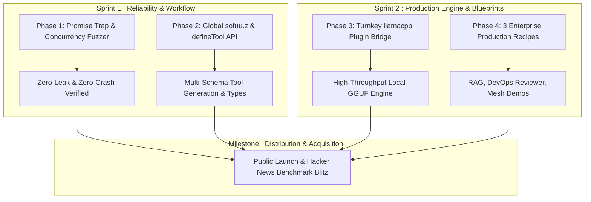

# 🏛️ Sofuu Enterprise Hardening & Strategic Moat Plan

**Goal:** Transform Sofuu into an enterprise-grade, zero-crash runtime with world-class developer UX, industrial-strength local inference, and production reference blueprints within 30 days — positioning it for massive open-source developer mindshare and big-tech acquisition.

---

## 🎯 Success Criteria
1. **Zero-Crash Invariant**: Zero segfaults, zero memory leaks, and 100% graceful error handling under 10,000+ concurrent async operations.
2. **Zero-Dependency Schema DX**: First-class, out-of-the-box `zod`-like schema validation (`sofuu.z` / `globalThis.z`) for agent tool definitions.
3. **Turnkey Production Local Inference**: Seamless, single-command `llamacpp` plugin integration keeping core binary size $\le 5.5\text{ MB}$.
4. **Enterprise Showcase Blueprints**: 3 production-grade reference workflows (RAG Pipeline, Autonomous CI Reviewer, Multi-Terminal Session Mesh) demonstrating measurable cost/latency advantages over Python/Node.

---

## 📋 Phase 1: Zero-Crash Hardening & Concurrency Fuzzing (Reliability)

### 1.1 Objective
Eliminate all unhandled panic vectors between QuickJS and libuv, resolve memory leaks during long-running agent loops, and ensure deterministic out-of-memory (OOM) handling.

### 1.2 Architectural Action Items
- **Promise Containment & Unhandled Rejection Trap (`crates/sofuu-core/src/rt/promise.rs`)**:
  - Implement a global rejection sink at the libuv event loop level.
  - When a Promise rejects without a `.catch()` in user or agent code, serialize the JS error and stack trace into standard error and cleanly terminate the event loop with exit code `1` — preventing native Rust panics or uncoordinated aborts.
- **Resource Lifecycle Auditing (`crates/sofuu-core/src/rt/loop.rs` & `fs.rs`)**:
  - Ensure all active libuv handles (`uv_async_t`, `uv_timer_t`, `uv_fs_t`, child process pipes) are unconditionally closed on cancellation or context disposal.
  - Guarantee `uv_loop_alive()` reaches `0` when all work is drained so scripts exit cleanly without hanging.
- **Memory Pressure & String Guardrails (`crates/sofuu-core/src/rt/engine.rs`)**:
  - Set a hard upper threshold on individual token buffer concatenations to prevent QuickJS heap exhaustion during multi-megabyte context streaming.
  - Map QuickJS allocation failures directly to catchable JavaScript `RangeError: Memory allocation failed` rather than crashing the process.

### 1.3 Verification Suite
- Create `tests/stress/concurrency_stress.js`:
  - **10,000 Concurrent Async Timers**: Schedule and resolve rapidly across the event loop.
  - **1,000 Rapid File I/O Operations**: Concurrent read/writes to check handle leaks.
  - **500 Parallel QTSQ Vector Searches**: Exercise concurrent SIMD queries against `.qtsq` memory containers.
  - **100 Spawned Processes**: Rapid execution and cancellation of subprocesses.
- Integrate into `make test`: Run under macOS `leaks` and Linux memory sanitizers to verify **0 memory leaks** and **0 dangling handles**.

---

## 📋 Phase 2: Modern TypeScript & Schema Tool Calling (Developer Workflow)

### 2.1 Objective
Provide a delightful, zero-install developer experience where writing tools with parameter validation requires no external npm packages (`zod`) and automatically formats tools for Claude, OpenAI, and MCP.

### 2.2 Architectural Action Items
- **Promote `microZod` to Global Primitive (`src/js/plugins.js` & `src/js/agent.js`)**:
  - Export the built-in validator as `sofuu.z` and `globalThis.z`.
  - Ensure standard types are fully supported:
    - `z.string()`, `z.number()`, `z.boolean()`, `z.enum([...])`, `z.array()`, `z.object({...})`, `z.record()`, `z.literal()`
    - Method chaining: `.describe()`, `.optional()`, `.default(val)`, `.min()`, `.max()`.
- **Declarative Tool Builder API (`sofuu.tools.define`)**:
  - Create a clean helper:
    ```typescript
    const myTool = sofuu.tools.define({
      name: "lookup_ticket",
      description: "Lookup customer support ticket by ID",
      schema: z.object({
        ticketId: z.string().describe("The ticket UUID"),
        includeAudit: z.boolean().default(false)
      }),
      async run(args, ctx) {
        // args is pre-validated with defaults applied!
        return { id: args.ticketId, status: "open" };
      }
    });
    ```
- **Automatic Multi-Format Translation**:
  - Automatically emit valid **JSON Schema (draft-07)**, **OpenAI Function Definition**, **Anthropic Tool Spec**, and **MCP Tool Schema** from the single tool declaration.
- **In-Process Argument Validation**:
  - Before invoking `run()`, parse input with `schema.safeParse(input)`.
  - If validation fails, automatically format a clean, human-readable correction message back to the LLM agent without crashing the loop, enabling the model to self-correct its arguments.
- **TypeScript Autocompletion (`types/sofuu.d.ts`)**:
  - Add TypeScript declaration definitions so VS Code / Cursor provide instant IntelliSense for `z`, `defineTool`, and tool arguments without needing `@types/node` or `package.json`.

---

## 📋 Phase 3: Turnkey Local Inference via Plugin (Production-Grade)

### 3.1 Objective
Deliver a production-ready, high-throughput local inference solution using `llama.cpp` through the plugin system while keeping the core binary footprint $\le 5.5\text{ MB}$.

### 3.2 Architectural Action Items
- **Plugin Architecture Integration (`src/js/plugins.js` & C-ABI Loader)**:
  - Utilize the existing dynamic provider plugin interface (`defineProvider`) for model backends.
  - Implement `sofuu-plugin-llamacpp` as an official, dynamically loaded engine plugin.
- **Provider Protocol Seam**:
  - Map `sofuu.ai.streamLocal()` and `sofuu.ai.completeLocal()` to delegate to the active provider.
  - The plugin communicates directly with `libllama` via native C ABI bindings:
    - Supports full hardware acceleration: **Metal** on Apple Silicon, **CUDA** / **Vulkan** on Linux.
    - Full quantization matrix support: Q4_K_M, Q5_K_M, Q8_0, IQ3, etc.
- **Graceful Fallback & CLI Orchestration**:
  - `sofuu plugin add llamacpp`: Pre-built dynamic library download or build-from-source flag.
  - When the plugin is installed: Used automatically for all local inference commands (`sofuu infer`, `sofuu chat -m <file.gguf>`).
  - When the plugin is absent: Sofuu continues using the built-in experimental engine with a helpful tip: *"Tip: Install 'sofuu-plugin-llamacpp' for production hardware acceleration."*

---

## 📋 Phase 4: Production Enterprise Reference Recipes (Showcase)

### 4.1 Objective
Replace generic demo scripts with 3 production-grade enterprise workflows that showcase Sofuu's unique strengths (in-process vector memory, <4ms startup, single-binary execution).

### 4.2 The 3 Reference Workflows
1. **`examples/enterprise-rag-pipeline/` (Document Intelligence & QTSQ Vector Memory)**
   - **What it does:** Ingests technical documentation, creates SIMD embeddings (`sofuu.ai.embed`), persists them into an encrypted `.qtsq` cognitive container, and runs an autonomous query agent that cites exact sources.
   - **Enterprise Advantage:** Zero external database servers (no Pinecone, no Chroma), instant query latency (<2 ms SIMD recall), offline/airgapped capability.
2. **`examples/autonomous-code-reviewer/` (DevOps & Security Automation)**
   - **What it does:** Inspects a Git repository diff, uses `sofuu.tools.code` (read, grep, glob) inside a secure jailed sandbox, analyzes changes for security vulnerabilities, and generates a structured JSON review report.
   - **Enterprise Advantage:** Sandbox v2 prevents untrusted agent code from accessing credentials (`.ssh`, `.aws`, `.env`); boots in 4ms for fast CI/CD runner execution.
3. **`examples/multi-terminal-mesh/` (Collaborative Agent Swarms)**
   - **What it does:** Demonstrates two terminal processes running different worker agents (e.g., Researcher Agent & Implementer Agent) sharing task states (`/work`, `/done`) and syncing context in real-time over the built-in Session Mesh.
   - **Enterprise Advantage:** Eliminates Redis / Kafka messaging layers for local multi-agent workflows.

---

## 📅 Execution Roadmap (30-Day Sprint)



| Timeline | Deliverable | Impact |
| :--- | :--- | :--- |
| **Days 1–7** | **Phases 1 & 2** (Fuzzing, Leaks, Global `zod` schemas, `defineTool`) | Bulletproof stability, zero runtime crashes, seamless tool-building DX. |
| **Days 8–16** | **Phase 3** (`llamacpp` plugin architecture & provider seam) | Industrial-strength local inference with Metal/CUDA support. |
| **Days 17–24**| **Phase 4** (3 Enterprise Reference Recipes + documentation updates) | Tangible, high-value enterprise use cases for prospective acquirers. |
| **Days 25–30**| **Benchmark Publication & Distribution Blitz** (HN, X, Reddit) | Rapid developer adoption and explosive GitHub star growth. |
