<p align="center"></p>

# ⚡ Sofuu (素風)

> *Sofuu is a general-purpose runtime for AI — built to run anywhere from servers to smart devices. A compact, sovereign systems engine (Rust/C core, QuickJS/libuv) combining in-process CPU/GPU inference (experimental), multi-format models (GGUF + SafeTensors), autonomous agent loops, encrypted cognitive vector memory (QTSQ), and native MCP in a single <= 5.5 MiB binary (5.39 MiB on macOS arm64 with bundled QTSQ cognitive memory; the Linux builds are 5.88 MiB arm64 and 6.80 MiB x86_64 and currently exceed the cap). Zero daemons, zero external dependencies.*

[](LICENSE)
[](https://github.com/sofuu-runtime/sofuu/releases)
[](https://sofuu.xyz)
[](https://sofuu.xyz/install)
[](https://sofuu.xyz)
[](https://sofuu.xyz/docs#plugins)
[](https://sofuu.xyz/docs)
[](https://x.com/sofuu_runtime)

> 🚧 **Active development — iterating fast.** APIs may change before a stable release.

---

## What is Sofuu?

Sofuu is **a general-purpose runtime for AI — built to run anywhere from servers to smart devices**.

Sofuu is **not just a terminal coding agent or a desktop model runner**; the terminal assistant (`sofuu chat`) is merely one first-party demonstration application running on the engine. Sofuu is the foundational systems substrate engineered to collapse the fragmented AI stack (Python/Node + LangChain + Chroma + Ollama + FastAPI) into a single in-process, self-contained runtime.

While TypeScript and JavaScript serve as the ergonomic high-level orchestration surface, the engine itself is an ultra-lean systems core (Rust + C) with a clean C ABI. Everything AI applications require is built directly into the single native binary — no npm packages, no Python environments, and no background daemons required:
- **In-process local LLM inference** (**experimental** — built-in engine is early stage; for production use llama.cpp or another backend via the plugin system) (GGUF, SafeTensors, PyTorch, NumPy on Metal / NEON / AVX2) and cloud streaming
- **Autonomous agent loops** with native tools, prompt sovereignty, and sandboxed execution
- **Continuous Memory Architecture (CMA v2)** — on-device encrypted vector brain in `.qtsq` containers (bundled on macOS and Linux)
- **Model Context Protocol (MCP)** — first-class client and server support
- **Unified R7 Security Policy** — deterministic firewall for tools, shell, filesystem, network, and MCP
- **Async HTTP server & SIMD vector mathematics**

### Where Sofuu Runs
Sofuu is built from first principles with a hard **$\le 5.5\text{ MiB}$ binary cap**, a **22.5 ms median cold start** (`sofuu eval "1+1"`, wall clock including process spawn — see [BENCHMARKS.md](BENCHMARKS.md)), and **zero-JIT execution** (making it 100% compliant with strict platform policies like the iOS App Store and RTOS environments). This enables it to run identically across diverse hardware form factors:
- **Cloud & Edge Servers:** Headless microservices, streaming LLM proxies, and containerized autonomous agents with microsecond warm-up.
- **Developer Workstations:** High-throughput local agent workspaces, standalone compiled CLI tools (`sofuu compile`), and zero-config desktop tools.
- **Mobile Devices (iOS & Android):** Shipped as an embeddable C ABI library (`libsofuu`) with Swift and Kotlin bindings.
- **Smart Devices, Wearables & Physical Computing:** Drones, robotics, smart watches, AR glasses, and edge IoT gateways — where tight RAM budgets ($<30\text{ MB}$), offline on-device tensor evaluation, local encrypted memory, and deterministic hardware-safety boundaries allow building ambient intelligence without relying on constant cloud roundtrips or bloated OS runtimes.

---

## Features

- **Universal runtime with TS/JS orchestration** — QuickJS (ES2023) + libuv event loop with cooperative scheduler (W3C `scheduler.yield()`, microtask starvation protection), AOT bytecode snapshotting, zero-copy TypedArray SIMD memory bridge, native `AsyncLocalStorage` context propagation, deterministic instruction-metered sandboxing, a 22.5 ms startup median on an Apple M2 Pro (wall clock incl. process spawn, 31 runs — see [BENCHMARKS.md](BENCHMARKS.md); the older 3.8 ms table row is historical), TypeScript runs with no compiler step, and `sofuu bundle` ships one self-contained file
- **Local edge inference** (**experimental** — built-in engine; production use: llama.cpp or another backend via plugin) — `sofuu infer`, `sofuu.ai.streamLocal()`, `sofuu chat -m <model>`; multi-format (GGUF, SafeTensors, PyTorch `.pt`, NumPy `.npy`/`.npz`), up to ~195 tok/s prefill and ~69 tok/s decode on this battery's hardware, in-place KV cache compaction & sliding-window attention past context limits
- **Cloud LLM streaming** — `sofuu.ai.stream` / `complete` over OpenAI, Anthropic, or any OpenAI-compatible endpoint (BYO key); per-model context/effort registry, no default model
- **Agents + workflows** — `sofuu.agent.define/run`, modular domain toolpacks (`coding`, `web`, `memory`, `system`), prompt sovereignty, tool-aware task-gate, budgets, cancel, trace rendering; generalized session documents (`chat`, `agent`, `workflow`, `pipeline`) with state container
- **Encrypted local brain** — `sofuu.memory` over `.qtsq` files: recall across sessions, `/remember` pins facts, portable brain cards (`/share` + `/import`), optional HTTP serving, now fully bundled on Linux and macOS
- **Offline embeddings** — `ai.embed` (768-dim, zero-byte model), `ai.embedImage` (joint text/image space), SIMD `similarity`/`dot`/`l2`
- **Speech in/out** — `ai.transcribe` / `ai.speak` via provider endpoints or on-device OS engines
- **Long-context Q&A** — `sofuu.rlm.query` answers over contexts far larger than any model window via a sandboxed reader loop
- **Context-economy gates** — `sofuu.ml` freshness/supervisor/compaction/relevance models (~8k params each) advise the loop to cut token waste; hard off via `/ml off` or `SOFUU_NO_ML=1`
- **MCP + HTTP + web** — `sofuu.mcp.connect/serve`, `sofuu.http.createServer`, keyless `sofuu.web.search/open`
- **Modern npm + Web Streams** — conditional `package.json#exports` (subpaths, `./*` wildcards, `import`/`require` conditions), and `Response.body` as a real `ReadableStream` (`getReader`, `pipeThrough(new TextDecoderStream())`, `for await`), so official AI SDK streaming loops run unmodified; unsupported packages fail with a coded, actionable diagnostic instead of a cryptic error
- **Embeddable** — `libsofuu` C ABI with Swift/Kotlin wrappers; QuickJS has no JIT, so iOS App Store policy is satisfied by design

---

## Install

```bash
# 1. One-line install (Linux & macOS, auto-detects architecture)
curl -fsSL https://sofuu.xyz/install | sh

# 2. Direct Downloads (with bundled QTSQ cognitive vector memory)
#    → Linux x86_64:        https://sofuu.xyz/downloads/sofuu-linux-x86_64.tar.gz
#    → Linux arm64 (RPi 5): https://sofuu.xyz/downloads/sofuu-linux-arm64.tar.gz
#    → macOS arm64:         https://sofuu.xyz/downloads/sofuu-darwin-arm64.tar.gz

# 3. npm
npm install -g sofuu      # or: npx sofuu
```

> **Platforms: Official standalone binaries available for macOS (Apple Silicon) and Linux (`x86_64` and `arm64` / Raspberry Pi 5).** Building from source works anywhere (see below).

Release integrity: every archive ships a SHA-256 digest, and `install.sh`
verifies it before unpacking (refusing to install when no checksum tool is
present). Each release also carries a CycloneDX 1.5 SBOM
(`sofuu-sbom.json`); regenerate it with `make sbom`. The signed manifest
(`SHA256SUMS.minisig`) is wired through `scripts/sign_release.sh` and
`install.sh` — verification turns on the moment a minisign public key is
published in `install.sh`, and until then the script says plainly that it is
installing on SHA-256 alone. See [`SECURITY.md`](SECURITY.md) for the
security scope — what R7 guarantees and what residual risks you accept.

---

## Release status (2026-10-31)

`sofuu version` prints the build revision next to the semver, so a binary can be
traced to the commit that produced it:

```
sofuu 0.3.0-beta
revision 98eb89352
quickjs 2024-01-13
platform: macOS arm64
```

| Artifact | Size | vs. the 5.5 MiB (5,767,168 B) cap |
| --- | --- | --- |
| macOS arm64 — this tree, `make size-check` | 5,559,904 B (5.30 MiB) | **passes**, 202 KB headroom |
| macOS arm64 — published archive | 5,655,808 B (5.39 MiB) | passes |
| Linux arm64 — published archive | 6,163,520 B (5.88 MiB) | **over** |
| Linux x86_64 — published archive | 7,130,904 B (6.80 MiB) | **over** |

The cap is enforced rather than asserted: `make size-check` fails the build over
it, and `scripts/verify-dist.sh` fails a release that ships an artifact over the
cap, a binary with no HEAD stamp, or one built from a dirty tree.

```bash
make size-check      # host build against the cap
sh scripts/verify-dist.sh   # release gate: stamp, tree state, every artifact
```

### Known limits

- **The Linux archives are over the cap** and predate this engine; the next
  release rebuilds and re-stamps them. macOS is already under.
- **SwiftPM and CocoaPods coordinates do not resolve yet.** The `v0.3.0-beta`
  tag carries a placeholder checksum and a v0.2.0 asset URL, and no xcframework
  exists in any tag tree — so the embedding docs now say that instead of
  pointing at an install that cannot work. A new tag with a stamped
  `Package.swift` (`scripts/stamp-swiftpm.sh`) closes it.
- **TypeScript is erased, never checked.** Object literals, parameter
  properties, `enum`s, generics, `implements`/`abstract`, `as`/`satisfies`,
  `declare`, and `export type`/`export interface` are handled; `namespace` and
  decorators are refused with a `SyntaxError` rather than mistranslated.
- **Deliberately absent globals:** `WeakRef`, `FinalizationRegistry`,
  `WebAssembly`, `Intl`, `WebSocket`, `EventSource`. QuickJS has no weak
  references, so a stand-in would be the leak the caller was avoiding.
- **`SOFUU_REGEX_BUDGET_MS`** (default `1000`, `0` disables) bounds a single
  regular-expression call, so a pathological pattern costs a caught error
  instead of the loop.

---

## Quick Start

### The 10-Second "Hello World" (Zero Keys, Zero Downloads)

Most AI frameworks require hunting down an API key or downloading 2 GB of model weights before running a single line of code.

With Sofuu, native AI primitives work the millisecond it installs:

```bash
# 1. Install Sofuu (Linux & macOS)
curl -fsSL https://sofuu.xyz/install | sh

# 2. Run the 10-second Hello World directly in your terminal:
sofuu eval '
const brain = sofuu.memory.open("./brain.qtsq", 768);
brain.remember(sofuu.ai.embedLocal("native AI runtime"), "Sofuu boots in 2ms with zero daemons.");
const [match] = brain.recall(sofuu.ai.embedLocal("fast runtime"), 1);
console.log("Recalled from vector brain:", match.text);
'
```

```text
Recalled from vector brain: Sofuu boots in 2ms with zero daemons.
# Completed in 2ms · 0 background daemons · 0 cloud API calls
```

Or write a 4-line script `hello.js` and run `$ sofuu run hello.js`:

```js
// hello.js — native AI in standard JavaScript
const brain = sofuu.memory.open("./brain.qtsq", 768);

// 1. Embed and persist facts into encrypted on-disk vector storage (768-dim, 0-byte model)
brain.remember(
  sofuu.ai.embedLocal("native AI runtime"),
  "Sofuu executes AI natively in JavaScript with zero background daemons."
);

// 2. Query offline vector semantic memory via hardware SIMD in microseconds
const [memory] = brain.recall(sofuu.ai.embedLocal("daemons"), 1);
console.log("Recalled:", memory.text);
```

```bash
sofuu run hello.js
```

**What just happened in 2ms?**
- **0-Byte Model Embeddings:** Generated 768-dimensional vector representations offline on CPU SIMD with no external model file.
- **Embedded Vector Database:** Created and indexed an AES-256 encrypted `.qtsq` cognitive memory container directly on disk.
- **Zero Daemons:** Executed in-process in $\approx 2\text{ ms}$ with no Docker containers, no background daemons, and zero network calls.

---

### Interactive Chat & Cloud Streaming

**Pick a provider on first launch — there is no default model:**

```bash
sofuu        # guided setup asks for provider + model (+ key)
             # later: /provider to switch, /model to change model
```

| endpoint format              | example provider | example `model`     | API key              |
|------------------------------|------------------|---------------------|----------------------|
| OpenAI (`/chat/completions`) | `"openai"`       | `"gpt-5"`           | `OPENAI_API_KEY`     |
| OpenAI (`/chat/completions`) | `"openrouter"`   | `"z-ai/glm-4.6"`    | `OPENROUTER_API_KEY` |
| Anthropic (`/v1/messages`)   | `"anthropic"`    | `"claude-sonnet-4-6"` | `ANTHROPIC_API_KEY` |
| local server (`/api/chat`)   | `"ollama"`       | `"llama3"`          | none                 |

Any other OpenAI-compatible or Anthropic endpoint works too — add it with `/provider`. Settings persist in `~/.sofuu/config.json`.

**Stream an AI response — no packages, no SDK setup:**

```js
// server.js
const server = sofuu.http.createServer(async (req, res) => {
  res.writeHead(200, { "Content-Type": "text/plain" });
  const stream = sofuu.ai.stream("Explain how SIMD works.", {
    provider: "openai",
    model: "gpt-4o",   // a model is REQUIRED
  });
  for await (const chunk of stream) {
    res.write(chunk.text);
  }
  res.end();
});
server.listen(3000, "0.0.0.0");
```

```bash
sofuu run server.js
```

**TypeScript just runs:**

```bash
sofuu run hello.ts
```

**Run an agent with web search — still zero packages:**

```js
// research.js
sofuu.agent.define({
  name: "researcher",
  system: "You research precisely. Search first, then answer with sources.",
  tools: ["code", "web"],
  memory: "agent",
});

const r = await sofuu.agent.run("researcher", "What shipped in QuickJS 2024?");
console.log(r.answer);
```

```bash
sofuu run research.js
```

---

## Local Inference (Experimental)

> ⚠️ **EXPERIMENTAL**: The built-in in-process inference engine is in an early stage of development and provided for local experimentation. It may not reliably support all model architectures or quantizations. For production workloads or maximum throughput, we strongly recommend routing inference through **llama.cpp** or other dedicated inference backends via Sofuu plugins.

Sofuu provides a zero-dependency, in-process inference engine supporting **GGUF**, **HuggingFace SafeTensors**, raw **PyTorch checkpoints (`.pt` / `.pth`)**, and **NumPy arrays (`.npy` / `.npz`)**:

```bash
# One-shot generation from a quantized GGUF model:
sofuu infer ./Qwen-3-0.6B-Q4_K_M.gguf "Explain virtual memory paging." --max-tokens 200

# One-shot generation from a HuggingFace SafeTensors directory (LFM-2 BF16 or MLX4):
sofuu infer ./liqiud-350 "Explain quantum entanglement in simple terms." --max-tokens 50

# CPU-stream KIVI 2-bit / 4-bit quantized KV (no GPU: on a Metal build --kivi
# refuses unless SOFUU_KIVI_CPU=1 - it disarms the GPU client and measured 5.1
# tk/s vs 99.3 tk/s for the f32 cache on the GPU decode path):
SOFUU_KIVI_CPU=1 sofuu infer ./model.gguf "Summarize this long document" --kivi --kivi-bits 4

# Eliminate CPU cache thrashing via Non-Temporal Streaming Weights (Cache-Bypass):
sofuu infer ./model.gguf "Explain distributed consensus" --streaming-weights

# Accelerate decode throughput via PowerInfer/DejaVu Dynamic FFN Sparsity:
sofuu infer ./model.gguf "Explain general relativity" --dynamic-ffn

# Multi-Path Lookahead Tree Speculation (evaluate candidate token trees via single DRAM weight sweep):
sofuu infer ./model.gguf "def fibonacci(n):" --lookahead

# Generate past context limits with in-place KV compaction & sliding-window attention:
sofuu infer ./model.gguf "Write an essay" --ctx 256 --swa 128 --max-tokens 1000

# Interactive chat powered by any local model:
sofuu chat -m ./Qwen-3-0.6B-Q4_K_M.gguf
```

```javascript
// In-process streaming in JS/TS — no network calls, no background servers:
const stream = sofuu.ai.streamLocal("Explain vector quantization.", {
  model: "./Qwen-3-0.6B-Q4_K_M.gguf",  // or "./liqiud-350"
  temperature: 0.7,
  maxTokens: 500,
});
for await (const chunk of stream) {
  process.stdout.write(chunk.text);
}
```

### Verified Hardware Benchmarks

| Hardware Target | Model & Precision | Cold Load | Prompt Prefill | Autoregressive Decode | Notes |
|---|---|---|---|---|---|
| **Apple M2 Pro** | `Qwen3-0.6B` (Q4_K_M) | **417 ms** | **879.1** GPU / 757.2 CPU tk/s | **139.3** GPU / 53.5 CPU tk/s | 1.16× prefill, **2.60×** decode vs CPU |
| **Apple M2 Pro** | `Qwen3-0.6B` (Q3_K) | — | **699.8** GPU / 559.0 CPU tk/s | **135.3** GPU / 130.3 CPU tk/s | 1.25× / 1.04× — Q3_K has no GPU GEMM gate, so prefill is CPU-class |
| **Apple M2 Pro** | `Qwen2.5-0.5B` (Q4_0) | — | **857.6** GPU / 203.1 CPU tk/s | **162.1** GPU / 96.7 CPU tk/s | **4.22×** prefill since the q4_0 wide-chunk GEMM (2026-10-27); was 1.6× |
| **Apple M2 Pro** | `SmolLM2-360M` (Q8_0) | — | 918.4 GPU / **1421.7** CPU tk/s | **164.4** GPU / 126.1 CPU tk/s | CPU wins prefill at this size; GPU still wins decode |
| **Apple M2 Pro** | `TinyMistral-248M` (Q4_K_M) | — | **2453.2** GPU / 1983.4 CPU tk/s | **262.5** GPU / 126.2 CPU tk/s | 1.24× / **2.08×** — head_dim 32, the smallest arch verified |
| **Apple M2 Pro** | `TinyMistral-248M` (Q8_0) | — | 1608.6 GPU / **1832.7** CPU tk/s | **286.7** GPU / 158.3 CPU tk/s | Highest decode of any model here |
| **Apple M2 Pro** | `Llama-3.2-1B-Instruct` (Q8_0) | — | 397.2 GPU / **628.8** CPU tk/s | **79.6** GPU / 51.5 CPU tk/s | 0.63× / 1.55× — GPU prefill loses at short depth, wins past ~400 tokens |
| **Apple M2 Pro** | `Sharp-MiniCPM5-2B` (Q6_K_XL) | **661 ms** | **196.3** GPU / 136.2 CPU tk/s | **43.6** GPU / 29.2 CPU tk/s | 1.44× / 1.49× |
| **Apple M2 Pro** | `Phi-4-mini-reasoning` (Q6_K_XL, phi3) | **772 ms** | **123.0** GPU / 90.4 CPU tk/s | **7.2** GPU / 2.9 CPU tk/s | phi3 has a GPU route since 2026-10-27; decode ~2× at steady state |
| **Apple M2 Pro** | `Spark-X2.5-4B` (Q4_K_M, head_dim 256) | — | 88.3 GPU / 81.9 CPU tk/s | 23.6 GPU / 21.5 CPU tk/s | Own CPU backend — the GPU client is never armed, so these two columns are the same engine |
| **Apple M2 Pro** | `K2-Horizon-4B` (Q8_0) | — | 23.3 GPU / **78.5** CPU tk/s | **24.6** GPU / 1.1 CPU tk/s | 0.30× prefill, **22.4×** decode — the largest decode win measured |
| **Apple M2 Pro** | `Qwen3-8B` (Q4_K_M) | — | 18.3 GPU / **38.8** CPU tk/s | **11.3** GPU / 1.7 CPU tk/s | 0.47× / **6.6×** |
| **Apple M2 Pro** | `Ternary-Bonsai-2-9B` (PTQ1_0) | — | **5.8** GPU / 3.1 CPU tk/s | 2.9 GPU / 2.8 CPU tk/s | Ternary weights, dequant path |
| **Apple M2 Pro** | `Ternary-Bonsai-2-9B` (PQ2_0-MTP) | — | **8.0** GPU / 4.7 CPU tk/s | 5.9 GPU / 5.9 CPU tk/s | Product-quantised 2-bit |
| **Apple M2 Pro** | `Ternary-Bonsai-2-27B` (PTQ1_0) | — | **1.4** GPU / 0.8 CPU tk/s | 1.0 GPU / 1.0 CPU tk/s | Loadable; decode is weight-stream bound at 5.54 GB/token |
| **Apple M2 Pro** (M2 Pro) | `liqiud-350` (BF16 SafeTensors) | **127.9 ms** | **79.0 tk/s** | **50.1 tk/s** | 19.1× speedup via NEON bit-extension |
| **Apple M2 Pro** (M2 Pro) | `liquid` (MLX 4-bit SafeTensors) | **119.2 ms** | **20.7 tk/s** | **28.4 tk/s** | 20.25× speedup via group scale/bias broadcast |
| **Apple M2 Pro** (M2 Pro) | `gemma-2b` (SafeTensors) | — | **6.9 tk/s** | **16.4 tk/s** | Dense f16/BF16 path |
| **Apple M2 Pro** (M2 Pro) | `gpt-x3-150m` (SafeTensors) | — | **26.0 tk/s** | **42.6 tk/s** | Dense f16/BF16 path |
| **Apple M2 Pro** | `Qwen3-0.6B` Q3_K_M mix, `SmolLM2-360M` Q3_K, `gemma-2-2b` Q4_K_S | — | **refused** | **refused** | Carries Q5_K / Q5_0 / Q5_1 tensors: *"3 tensor(s) use quant types that are not supported… Q5_K in particular has no CPU dot and no GPU kernel, so it is refused rather than half-supported"* |
| **Apple M2 Pro** | `Ternary-Bonsai-2-9B-mmproj`, `parakeet-tdt`, `laya-multilingual`, `glm-ocr` | — | **refused** | **refused** | Not text-LLM GGUFs: mmproj has no tokenizer, the two audio models have no `embedding_length`, and `glm-ocr` reports the unsupported arch `GlmOcrForConditionalGeneration` |
| **Raspberry Pi 5** (ARM64 musl) | `Qwen-3-0.6B` (Q4_K_M GGUF) | **880 ms** | **195–196 tk/s** | **26.0–26.1 tk/s** | Ahead of llama.cpp-11041 CPU on the same prompt (+11% prefill / +9% decode); q4_K tile GEMM |
| **Raspberry Pi 5** (ARM64 musl) | `Qwen-3-0.6B` (Q3_K_S GGUF) | **560 ms** | **145 tk/s** | **30.3 tk/s** | ~2× llama.cpp prefill, decode +7% (cost-aware speculative gate, serial after warmup) |
| **Raspberry Pi 5** (ARM64 musl) | `Llama-3.2-1B-Instruct` (Q8_0 GGUF) | **1.1 s** | **141–142 tk/s** | **10.1 tk/s** | Prefill 2.4× llama.cpp, decode +15%; speculative tree on longer generations (20+ tk/s) |
| **Raspberry Pi 5** (ARM64 musl) | `Sharp-MiniCPM5-2B` (Q6_K_XL GGUF) | **1.4 s** | **38.4–39.2 tk/s** | **5.8–5.9 tk/s** | Ahead of llama.cpp (+9% prefill / +6% decode, sampled — its greedy first token is EOS on the raw prompt) |
| **Raspberry Pi 5** (ARM64 musl) | `Spark-X2.5-4B` (Q4_K_M GGUF) | **2.1 s** | **25.3–25.4 tk/s** | **4.4 tk/s** | Ahead of llama.cpp (+11% prefill / +5% decode), matched prompt & context |
| **Raspberry Pi 5** (ARM64 musl) | `Ternary-Bonsai-2-9B` (PQ2_0 GGUF) | **440 ms** | **1.4 tk/s** | **0.7 tk/s** | Loadable only here (ternary-weight format); v1 dequant path, not yet optimized |

M2 Pro receipts: 2026-10-27, one binary for every row, `--temp 0` greedy, GPU arm =
`SOFUU_GPU_PREFILL=1 SOFUU_GEMM_MMA8=1`, CPU arm = the same binary with those flags absent. Prompt depth was
148 tokens with 16 generated for the small models, stepped down to 96/12, 64/8, 32/6 and 16/4 as model size
grows to bound runtime — so the big-model prefill ratios are **not** a like-for-like depth comparison (148
tokens is too short for GPU prefill to amortise setup; the same binary gives `Qwen3-0.6B` Q4_K_M 1469 vs 511
tk/s CPU at 400 tokens, 1616 vs 442 at 800, 1355 vs 399 at 1454). One run per cell, not ABBA; load 3.5–5.1.
Load times are warm page-cache.

Quantized KV is opt-in, not a speed win: `--kv-dtype 8|4` measured **slower** than the f32 cache at every context tested here (Qwen3-0.6B, 493/1497/2993/3994 tokens: 8-bit decode -10.3%/-19.3%/-29.2%/-31.0%, 4-bit -12.0%/-19.1%/-28.3%/-31.4%, prefill -63% to -87% for both), and `--kivi` on Apple Silicon only reaches the CPU layer loop (5.1 tk/s vs 99.3 tk/s f32 on the GPU at ~890 tokens) - both because the quantized attention kernel spends more time on dequant ALU than it saves in bytes (1.82x the f32 ms/token slope while reading 3.2x fewer bytes, and 4-bit reads 1.7x fewer bytes than 8-bit for the same time), so the flag buys KV memory (3.2x smaller) and never throughput; the numbers and the 4096-token hard stop are in [contract/KV4-OPERATOR-NOTE.md](contract/KV4-OPERATOR-NOTE.md).

Pi 5 receipts: 2026-10-26 battery, current main, 4× Cortex-A76 with NEON+dotprod at the adopted `arm_freq=2800` + 25 mV boot config, `performance` governor, 4 threads, temp 0, 234–252-token prompt, fresh llama.cpp build 11041 references from the same session. Load times are warm page-cache.

---

## Plugins & Extensibility

Sofuu is extensible from JavaScript or TypeScript with no build step: drop a
file in `./plugins/` (or list it in `sofuu.json`) and it is discovered,
validated and registered at startup. Every extension crosses the same
**five shields**, so an untrusted plugin cannot take the process down.

| Category | Factory | What it registers |
| --- | --- | --- |
| Action | `defineTool` | an LLM-callable tool (zod or JSON Schema input/output) |
| Inference | `defineProvider` | a model backend (ollama, llama.cpp, OpenAI wire, custom) |
| Storage | `defineStorage` / `defineVectorStore` | a key/value store or a vector index (dual-write mirror of QTSQ) |
| Lifecycle | `defineService` | background service with `onStart`, `onTurnStart`, `onToolCall`, `onToolResult`, `onTurnEnd`, `onStop` |
| Description | `useOpenAPI` / `ingestMcp` | zero-code bridging of a REST API or an MCP server's tools |

The five shields, and the error each one raises:

1. **Schema** — input validated before the callable runs, output before the result is returned (`E_SCHEMA`).
2. **Policy & network jailing** — `permissions.net` allowlist plus a private-IP/SSRF egress guard and a jailed `ctx.fs` (`E_DENIED`).
3. **Circuit breaker** — CLOSED / OPEN / HALF_OPEN, one trial admitted under a concurrent burst (`E_CIRCUIT_OPEN`). A policy denial never trips it.
4. **Watchdog** — every call carries a hardware-timer deadline with an abort signal (`E_TIMEOUT`).
5. **Panic guard** — a throw, a rejected promise, a circular return or a BigInt result becomes a typed tool result; the host process keeps running (`E_TOOL`, `E_CAPABILITY`, `E_BACKPRESSURE`).

```bash
sofuu plugin init weather --category=tool   # scaffold ./plugins/weather.ts
sofuu plugin validate plugins/weather.ts    # parse + register + report
sofuu plugin test weather '{"city":"Guwahati"}'   # invoke once, print the envelope
sofuu plugin list                           # every registered plugin + circuit state
```

```ts
import { defineTool, z } from 'sofuu';

export default defineTool({
  name: 'weather',
  description: 'Current temperature for a city',
  schema: z.object({ city: z.string() }),
  timeoutMs: 5000,
  async run({ city }, ctx) {
    const res = await ctx.fetch('https://wttr.in/' + encodeURIComponent(city) + '?format=j1');
    if (!res.ok) throw new Error('weather upstream ' + res.status); // -> E_TOOL
    return { city, tempC: (await res.json()).current_condition[0].temp_C };
  },
});
```

TypeScript is accepted directly: the runtime strips annotations, interfaces,
type aliases, enums and generics textually before evaluating the file, so a
plugin never needs `tsc` at install time. Editor support is real `tsc`
though — `sofuu.d.ts` ships with the package and type-checks under
`--strict`.

Built-in provider adapters are plugin providers too: `ollama` and `llamacpp`
talk to a local server, `lmstudio` and `vllm` alias the OpenAI wire on their
default local ports, and `openai` requires a key. Select one with
`sofuu chat -p ollama` or `sofuu config provider ollama`. Their streaming is
delivered as a **buffered replay** (the whole body is read, then the deltas are
emitted in order) — incremental token delivery stays on the Rust native path,
which the CLI uses whenever the provider is one of the built-in engines.

Full guide: [docs/PLUGINS.md](docs/PLUGINS.md) · runnable examples:
[plugins/README.md](plugins/README.md) · typings: [sofuu.d.ts](sofuu.d.ts).

---

## Universal Execution Sandbox

`sofuu.sandbox` runs JavaScript or TypeScript in a **separate QuickJS runtime** —
own heap, own intrinsics, no host globals — under budgets you state. The
runtime never caps what you ask for: a 2-second deadline and a 5M-instruction
meter are defaults for untrusted model-written code, not ceilings.

```js
// One-shot: fresh realm, run, destroy.
const r = sofuu.sandbox.run("1 + 2 * 3");
r.result;      // 7
r.logs;        // captured console output
r.fuelUsed;    // instructions charged

// TypeScript just runs — no build step.
sofuu.sandbox.eval("const x: number = 42; x");   // 42

// Stateful realm with host bridges (sync or async, including real I/O).
const sb = sofuu.sandbox.create({
  preset: "compute",                       // strict | standard | compute | worker
  globals: {
    tenantId: "cust_98234",                // plain JSON
    queryInventory: async (sku) => inventory.get(sku),
  },
});
const report = await sb.eval(`
  const count = await queryInventory("WIDGET-01");
  return "tenant " + tenantId + ": " + count + " in stock";
`);
sb.close();
```

| Preset | Workload | Deadline | Fuel | Memory | Frozen prototypes |
| --- | --- | --- | --- | --- | --- |
| `strict` | untrusted LLM code | 2 s | 5M | 32 MB | yes |
| `standard` | developer scripting | 10 s | 20M | 64 MB | no |
| `compute` | math, simulations, ETL | 300 s | unlimited | 512 MB | no |
| `worker` | long-running background | none | unlimited | 256 MB | no |

- **Bridges** — a top-level function in `globals` becomes a native function
  inside the realm. Arguments and results cross as JSON; a promise-returning
  function gives the sandbox a real promise, and a promise that needs the host
  loop (fetch, fs) parks the run and resumes it transparently.
- **Isolation** — no `process`, `fetch`, `require`, `sofuu` or filesystem
  unless you bridge it; `freezePrototypes` locks the intrinsics so
  `Object.prototype.x = ...` cannot stick across turns.
- **Ingest** — TypeScript (`ts: 'auto'`, including enums) and optional JSX
  (`jsx: true`) are handled in RAM, with the script evaluated as written first
  so a stripper can never change valid JavaScript.
- **Console** — `console: 'capture' | 'inherit' | 'ignore' | (level, ...args) => {}`.

Full guide: [docs/SANDBOX.md](docs/SANDBOX.md) · adversarial gate:
`make sandbox-stress` (26 cases) · typings: `sofuu.sandbox` in [sofuu.d.ts](sofuu.d.ts).

---

## 24/7 Agent Observability & Crash Recovery

Sofuu includes an append-only JSONL trace substrate designed for reliable, long-running autonomous agents:

* **Append-Only Tracing** — Every turn and step appends to `.sofuu/logs/agent-<run_id>.jsonl` with total-order sequence numbers (`seq`), timestamps, and step counters.
* **Secret Redaction** — Sensitive API keys, tokens, and passwords are automatically scrubbed at the write choke point before touching disk.
* **Fsync Durability** — Checkpoint events barrier through kernel `fsync()`. Tested against `SIGKILL` with zero data loss.
* **Post-Mortem Cards** — Unhandled crashes generate diagnostic cards in `.sofuu/crashes/<crash_id>.json` capturing the failed step, tool inputs, stack traces, and suggested fixes.
* **Checkpointed Resume** — Transparently restart execution from the last valid checkpoint with `sofuu resume <run_id>`.

```bash
sofuu logs                     # List past agent runs with derived status
sofuu logs show <run_id>       # Render colored, step-by-step transcript
sofuu logs --last-error        # View post-mortem card for the most recent failure
sofuu resume <run_id>          # Resume an interrupted or halted run from its last checkpoint
```

Full guide: [docs/OBSERVABILITY.md](docs/OBSERVABILITY.md) · specification: [docs/OBSERVABILITY-SPEC.md](docs/OBSERVABILITY-SPEC.md).

---

## CLI Reference

```bash
sofuu                        # Interactive AI chat
sofuu chat [-m <model.gguf>] # Chat (cloud API or local model)
sofuu dev [dir]              # AI-native full-stack dev server (--port, --host, --model)
sofuu infer <model> "<p>"    # Pure CPU LLM inference (GGUF, zero deps, experimental)
sofuu repl                   # JavaScript evaluation REPL
sofuu run <file.js|ts>       # Run a JavaScript/TypeScript file
sofuu eval "<code>"          # Evaluate a JS expression inline
sofuu bundle <entry.js> [-o <out.js>]  # Bundle into one file
sofuu compile <entry.ts> [-o <out>]    # Standalone single-file binary (--embed-brain)
sofuu install / add <package>          # npm packages
sofuu agent list             # List agent definitions (~/.sofuu/agents/*.js)
sofuu agent run <name> "task" [--json] # Run one agent headless
sofuu plugin list|validate|test|init   # Manage and test 5-shield plugins
sofuu logs [--last-error]    # Inspect runs and crash post-mortem cards
sofuu logs show <run_id>     # Step-by-step trace transcript
sofuu resume <run_id>        # Resume execution from last checkpoint
sofuu serve --brain <path>   # OpenAI-compatible HTTP server (--model, --model-id, --host, --port)
sofuu doctor                 # Health check: QTSQ link, brain round-trip, ctx
sofuu version / help
```

---

## Native Frontend & Full-Stack Engine (`sofuu dev`) — experimental

Sofuu embeds an experimental streaming JSX/TSX transpiler, file-based router, and React-API-compatible reactive micro-runtime (nominative reference; not affiliated with the React project) directly into the native binary. Develop full-stack reactive web applications with zero npm dependencies and zero background daemons.

```bash
sofuu dev [dir] --port 3000 --host 127.0.0.1
```

* **Zero-AST On-the-Fly Transpilation**: Converts JSX and strips TypeScript types in RAM with sub-millisecond latency.
* **React-API compatibility**: Write standard React code (`import React, { useState, useEffect } from "react"`, `import ReactDOM from "react-dom"`) with zero `npm install` — a nominative compatibility claim; Sofuu is not affiliated with the React project.
* **Complete Primitives Suite (38 primitives)**:
  - **Hooks & Lifecycle**: `useState`, `useReducer`, `useEffect`, `useLayoutEffect`, `useCallback`, `useMemo`, `useRef`, `useId`, `createContext`, `useContext`, `forwardRef`, `memo`, `useSyncExternalStore`, `useTransition`, `useDeferredValue`, `createPortal`, `Children`.
  - **Client-Side SPA Routing (`sofuu/router`)**: `<Link>`, `useRouter`, `usePathname`, `useSearchParams`.
  - **Data Fetching & Cache**: `useQuery`, `useMutation` with automatic SWR revalidation and caching.
  - **Global Reactive Store (`sofuu/store`)**: `createStore`, `useStore` without external state libraries.
  - **AI UI Streaming (`sofuu/ai`)**: `useChat()`, `useCompletion()`, `<ThinkingBlock />`, `<Markdown />`, `<CodeBlock />`.
* **Zero-Dependency Live Reload**: Built-in file watcher streams instant reloads on save via `/_sofuu/live` SSE.


**Chat slash commands** (`sofuu` / `sofuu chat`):

```text
/help  /model <name>  /provider <name>  /effort <low|medium|high|max>
/compact  /clear  /brain [on|off|info]  /rlm [on|off|auto]
/tools  /agents  /version  /exit

/remember <fact>  /why  /share [path]  /import <path>  /cost  /ghost [on|off]
@file[:start-end]  @name <task>  /watch <path>  /hooks  /resume [id]  /serve
/ml [on|off|info]  /sessions  /context [id]  /ctx [<tokens>]  /maxout [<tokens>]
/work <desc>  /done  /note <msg>  /notify <msg>  /sync [on|off]
```

`sofuu doctor` verifies the binary is healthy — QTSQ linked, brain write→read round-trip passes, and the current model's context window resolves. On a QTSQ build it also inspects the real brain store: vector space, segment manifest, per-tier histogram, capacity headroom, journal state, and last compaction. A non-zero exit means a hard dependency is missing.

---

## API Reference

### `sofuu.ai` — LLM Streaming, Vectors, Embeddings, Speech

```js
const stream = sofuu.ai.stream("What is the speed of light?", {
  provider: "openai", model: "gpt-5",   // model is REQUIRED
});
for await (const chunk of stream) {
  process.stdout.write(chunk.text);
}

const result = await sofuu.ai.complete("What is 2 + 2?", { provider: "openai", model: "gpt-4o" });
result.text;    // "4"
result.tokens;  // { input: 12, output: 1 }

sofuu.ai.similarity(a, b)   // Cosine similarity → [-1, 1]
sofuu.ai.dot(a, b)          // Dot product
sofuu.ai.l2(a, b)           // Euclidean distance

const v = sofuu.ai.embedLocal("hello world");              // 768-dim, offline, no model file
const vs = await sofuu.ai.embed(["a", "b"], { space: "hash-768" });
const batch = await sofuu.ai.embedBatch(["a", "b", "c"]);  // one call
const e = await sofuu.ai.embed("hi", { provider: "openai", model: "text-embedding-3-small" }); // BYO key
const iv = sofuu.ai.embedImage(await sofuu.fs.readFileBytes("shot.png"));  // image → joint space

const t = await sofuu.ai.transcribe(audioBytes, { provider: "openai", model: "whisper-1" });
const s = await sofuu.ai.speak("hello", { provider: "openai", model: "tts-1", voice: "alloy" });
```

### `sofuu.agent` — Agents & Sub-Agents

```js
sofuu.agent.define({
  name: "researcher",
  system: "You research precisely. Cite sources.", // Sacred: developer prompt is preserved 100%
  tools: ["web", "memory", "system"],             // Modular toolpacks or individual tool names
  memory: "agent",                                 // "shared" | "agent" | "off"
  budget: { maxSteps: 12, maxDepth: 2, maxWallMs: 300_000, taskGate: false }, // taskGate is opt-in & tool-aware
  agents: ["librarian"],                           // sub-agents reachable via `delegate`
});

const r = await sofuu.agent.run("researcher", "compare Rust and Zig GC stories");
r.answer; r.subRuns; r.usage; r.trace; r.stopped;

await sofuu.agent.runMany([{ agent: "researcher", task: "…" }], { concurrency: 4 });
sofuu.agent.cancel(runIdOrSignal);
sofuu.agent.renderTrace(r);   // human-readable run tree
```

#### Domain Toolpacks (`sofuu.tools.PACKS`)

Agents select only what they need — non-coding agents are never forced into terminal coding tools:

* **`coding`** (alias **`code`**) — `read_file`, `write_file`, `edit_file`, `apply_patch`, `grep`, `glob`, `list_dir`, `bash`, `code_eval`, `todo_write` (jailed to project dir; `SOFUU_NO_SHELL=1` strips `bash`).
* **`web`** — `web_search`, `web_open` (keyless DuckDuckGo search and readable page fetching).
* **`memory`** — `memory_search` (natural language vector search), `memory_remember` (persists facts directly to on-device QTSQ cognitive vector memory).
* **`system`** — `system_info` (runtime version, platform, CPU architecture, GPU engine, memory, capabilities).

#### `sofuu.session` — Generalized Session Documents

Standardized format for chat, autonomous agents, and multi-step workflows:

```js
const doc = {
  schema_version: 1,
  session: { id: "wf_1", kind: "workflow", agent: "etl_bot", status: "completed" },
  turns: [
    { input: "Extract records", output: "250 records extracted", kind: "extract", data: { count: 250 } },
    { input: "Transform schema", output: "Valid schema", kind: "transform", data: { errors: 0 } },
  ],
  state: { cursor: 250, completed: true },
  metadata: { pipeline: "nightly_sync" },
};

sofuu.session.import(doc);       // accepts plain JS objects or JSON strings
const exported = sofuu.session.export("wf_1");
```

### `sofuu.rlm` — Long-Context Q&A

```js
const res = await sofuu.rlm.query(bigText, "What error caused the outage?", {
  provider: "openai", model: "gpt-4o",
  maxRounds: 16, maxLlmCalls: 24, maxWallMs: 120000, trace: true,
});
res.answer; res.calls; res.rounds; res.stopped; res.trace;
sofuu.rlm.route(ctxTokens, windowTokens, question)  // → "rlm" | "plain"
```

### `sofuu.ml` — Context-Economy Gates

Tiny on-device models (~8k params each, offline, advise-only — the LLM always decides):

```js
JSON.parse(sofuu.ml.freshness.score(text, task, JSON.stringify({ kind: "web" })));
JSON.parse(sofuu.ml.supervisor.check(JSON.stringify({ run, step, tool, task, budget: 20 })));
JSON.parse(sofuu.ml.compaction.plan(JSON.stringify({ task, summary, recent, segments }), JSON.stringify({ budget: 1200 })));
JSON.parse(sofuu.ml.relevance.plan(JSON.stringify({ task, recent, candidates }), JSON.stringify({ kept: [0] })));
sofuu.ml.info();
```

### `sofuu.web` — Web Search & Page Reading (keyless default)

```js
const r = await sofuu.web.search("rust vs zig 2026", { count: 8 });
r.results;   // [{ title, url, snippet }]
const page = await sofuu.web.open("https://example.com/article");
page.text;
```

### `sofuu.mcp` — Model Context Protocol

```js
const client = await sofuu.mcp.connect("npx @modelcontextprotocol/server-filesystem /tmp");
await client.listTools();
await client.call("read_file", { path: "/tmp/notes.txt" });
client.disconnect();

const server = sofuu.mcp.serve();
server.tool("get_weather", { description: "…", schema: { … } }, async ({ city }) => { … });
server.start();   // stdio — works with any MCP client
```

### `sofuu.http` · `sofuu.fs` · `sofuu.spawn` · Globals

```js
const server = sofuu.http.createServer((req, res) => {
  res.writeHead(200, { "Content-Type": "application/json" });
  res.end(JSON.stringify({ status: "ok" }));
});
server.listen(8080, "0.0.0.0");
const res = await fetch("https://api.example.com/data");

const text = await sofuu.fs.readFile("./data.json", "utf8");
await sofuu.fs.writeFile("./output.txt", "Hello from Sofuu!");

setTimeout(() => console.log("done"), 1000);
await sleep(500);
process.env.API_KEY; process.argv; process.cwd();
```

### `sofuu serve` — OpenAI-compatible HTTP server

```bash
export SOFUU_SERVE_TOKEN=$(openssl rand -hex 24)  # --token works, but `ps` can see it
sofuu serve --model ./qwen3-0.6b-q4_k_m.gguf --model-id qwen3-0.6b \
            --host 127.0.0.1 --port 7707 --brain ./mem.sofuu
```

Every route except `GET /health` requires `Authorization: Bearer $SOFUU_SERVE_TOKEN`
(constant-time compare). `policy.http.auth: "none"` opts out explicitly and logs
a startup warning; `policy.http.deny` path prefixes are evaluated per request.

| Route | What it does |
| --- | --- |
| `GET /health` | liveness only, no auth, no data |
| `GET /v1/models` | configured ids (`--model-id`, default: the model file name) |
| `POST /v1/chat/completions` | OpenAI chat. `stream: true` → SSE `chat.completion.chunk` events + `data: [DONE]`; otherwise one JSON `chat.completion`. Honors `messages`, `max_tokens`, `temperature`, `stop` (up to 4), `tools`, and `stream_options.include_usage` |
| `POST /v1/completions` · `/infer` | raw text completion, no chat template |
| `POST /v1/embeddings` | OpenAI embeddings: 1–64 string inputs, 8192-token cap per input |
| `POST /v1/sessions` · `GET /v1/sessions` · `GET /v1/sessions/:id/turns` | process-local sessions (`kind`: chat, agent, workflow, pipeline) and recorded turns/state |
| `POST /v1/agent/runs` | `sofuu.agent.run`; SSE events when `stream: true`, else JSON |
| `GET /v1/tools[?category=...]` · `POST /v1/tools/:name/call` | tool inventory (filterable by domain pack: `coding`, `web`, `memory`, `system`), then policy-gated execution |
| `POST /remember` · `GET /recall?q=&k=` · `GET /memories` · `POST /forget` · `POST /share` | brain-backed memory (requires `--brain`) |

Errors use the OpenAI envelope `{error:{message,type,param,code}}`: `401`
`invalid_api_key`, `404` `model_not_found`, and policy denials are `403` with
`code: "policy_denied"` plus the `rule` that fired (the same verdict
`sofuu.policy.evaluate` gives in-process tool calls).

```bash
curl -s localhost:7707/v1/chat/completions \
  -H "Authorization: Bearer $SOFUU_SERVE_TOKEN" -H 'Content-Type: application/json' \
  -d '{"model":"qwen3-0.6b","messages":[{"role":"user","content":"Name three prime numbers"}]}'
```

---

## Conformance, stability and adoption

Sofuu publishes receipts, not claims:

- **[Security policy](SECURITY.md)** — the R7 security scope: what the firewall
  protects against, what it cannot, the residual risks you are accepting, and
  how to report a vulnerability.
- **[Contract suite](contract/CONFORMANCE.md)** — 52 clauses, currently
  51 PASS / 0 FAIL / 1 BLOCKED (macOS QTSQ build; the Linux rows are
  posture-only); the same page carries the live capability posture and the
  stability index.
- **[Surface matrix](contract/SURFACE-MATRIX.md)** — all 48 (primitive × surface)
  cells with status, missing operations and evidence.
- **[Stability index](contract/STABILITY-INDEX.md)** — T1 (guaranteed), T2
  (supported), T3 (experimental) for every public symbol.
- **[Performance scoreboard](contract/SCOREBOARD.md)** — the inference-parity
  engineering ledger against llama.cpp, fed by real sweep receipts.
- **[Adoption loop](contract/adoption/README.md)** — the P6 protocol and the
  external-deployment ledger.

Reproduce any of it from a checkout:

```bash
make deps
make && make libsofuu
bash scripts/contract/run_contract_tests.sh      # the 52-case board
bash scripts/verify-dist.sh dist ./sofuu         # install integrity
bash scripts/conformance_report.sh               # merged release report
python3 scripts/scoreboard.py --check --live-report dist/conformance-report.json
```

---

## Embed Sofuu (libsofuu)

```swift
// Package.swift — or: pod 'Sofuu', '~> 0.2'
import Sofuu

let sofuu = try Sofuu()
let vec = try sofuu.embed("the sky is blue")     // 768-dim, offline, 0-byte model
let brain = try Brain.openDefault(sofuu: sofuu)  // encrypted, local, yours
try brain.remember("the sky is blue")
let hits = try brain.recall("what colour is the sky?", k: 3)
```

```kotlin
// Gradle: implementation 'com.sofuu:sofuu-android:0.2.0'
// The published AAR links QTSQ, so sofuu.memory works on-device.
val vec = sofuu.embedLocal("hello")   // FloatArray, 768-dim, no network
```

```c
#include "sofuu_embed.h"
SofuuRuntime *rt = sofuu_rt_new(NULL);
char *out = NULL;
sofuu_rt_call(rt, "memory.open", "{\"path\":\"/tmp/b.qtsq\",\"dim\":768}", &out);
sofuu_free(out);
sofuu_rt_free(rt);
```

```bash
npx sofuu            # chat
npx sofuu run app.ts
```

From source: `make libsofuu`, `make dist-macos`, `make dist-ios` (xcframework), `make dist-android` (per-ABI .so).

---

## Build from Source

```bash
# Requirements: Rust (cargo), clang, cmake, make. libcurl for HTTP features
# (brew install cmake curl on macOS; the vendored libuv is built below).
git clone https://github.com/sofuu-runtime/sofuu
cd sofuu
make deps                                  # vendored libuv (required first build)

export SOFUU_QTSQ_DIR=/path/to/black-hole-disk
make                                       # cargo build --release
make libsofuu         # embeddable library (needed by the C-ABI conformance cases)
make test             # JS e2e suite
make size-check       # fails if the binary exceeds size cap
make bc-check         # fails if a shipped driver .bc lags its .js
./sofuu doctor        # QTSQ linkage + a real brain round-trip
```

`make` requires the QTSQ codec (mandatory core component) — brain persistence and sessions are fully operational in every build.

To cross-compile static Linux release binaries (`x86_64` and `aarch64` / Raspberry Pi 5):
```bash
bash scripts/cross/build_qtsq_cross.sh   # builds lean static libqtsq.a/libqtc.a for linux
bash scripts/cross/cross_compile.sh      # builds dist/sofuu-linux-x86_64 and dist/sofuu-linux-arm64
```

Key gates: `cargo test --release` · `make test` · `make headless-test` (all 5 C samples assert) · `make abi-check` · `make size-check` · `make bc-check` · `./sofuu doctor`.

---

## 100% Open Source

Sofuu and its underlying cognitive vector memory engine are **100% open source**:

- **Sofuu Runtime Engine**: [sofuu-runtime/sofuu](https://github.com/sofuu-runtime/sofuu) (MIT License)
- **QTSQ Cognitive Memory Core**: [haruhito2666/qtsq](https://github.com/haruhito2666/qtsq) (Apache License 2.0)

Use, inspect, modify, and distribute freely, commercially or non-commercially. Third-party components keep their own permissive licenses, all reproduced in [NOTICE](NOTICE): QuickJS, libuv, http-parser, libcurl, and libopus.

---

## Project and founder

Built by **Haruhito** — early-stage, bootstrapped, open-source, in active development.

- Website: [sofuu.xyz](https://sofuu.xyz)
- Source: [sofuu-runtime/sofuu](https://github.com/sofuu-runtime/sofuu)
- Memory Core: [haruhito2666/qtsq](https://github.com/haruhito2666/qtsq)
- Docs: [sofuu.xyz/docs](https://sofuu.xyz/docs)
- X (Twitter): [@sofuu_runtime](https://x.com/sofuu_runtime)
- Contact: [hello@sofuu.xyz](mailto:hello@sofuu.xyz)

---

## Roadmap

```mermaid
flowchart TD
    subgraph P1["Phase 1: Core Foundation (Shipped)"]
        subgraph P1_Substrate["Runtime Substrate"]
            S1["QuickJS ES2023 JIT-Free Engine"]
            S2["libuv Async Event Loop"]
            S3["Cooperative Scheduler (scheduler.yield)"]
            S4["Microtask Starvation Protection"]
            S5["Lexical TS Stripper (ts.rs)"]
            S6["ESM Bundler & Tree-Shaker (bundler.rs)"]
            S7["Strict Binary Cap (<= 5.5 MB Release)"]
        end
        subgraph P1_Memory["Cognitive Vector Memory (CMA v2)"]
            M1["Encrypted .qtsq Container Files"]
            M2["Zero-Byte 768-dim Offline Embeddings"]
            M3["ARM NEON & x86 AVX2 SIMD Kernels"]
            M4["Sub-2ms Top-K Cosine & L2 Search"]
            M5["Cross-Session /remember & /recall"]
            M6["Cryptographic Portable Brain Cards"]
        end
        subgraph P1_Security["Security & Tooling (Unified R7 Firewall)"]
            X1["CWD Lexical Filesystem Jail"]
            X2["Credential Redaction (.ssh, .aws, .env)"]
            X3["Domain Network Allowlisting & SSRF Filter"]
            X4["Catastrophic Shell Deny-List & SOFUU_NO_SHELL"]
            X5["Deterministic Instruction Fuel Metering"]
            X6["Native MCP Client & Server Trust Boundary"]
            X7["Jailed Coding Tools & Unified R7 Policy"]
        end
        subgraph P1_Agent["Agent & Mesh Layer"]
            G1["Multi-Step Reasoning Loop"]
            G2["Prompt Sovereignty (Zero Injected Prompts)"]
            G3["Token & Step Hard Budgets"]
            G4["Multi-Terminal Session Mesh (/work, /done)"]
            G5["Structured JSONL Observability & WAL"]
        end
    end

    subgraph P2["Phase 2: Hardening, Compatibility & Compiler (Active Sprint)"]
        subgraph P2_Compat["Node & Web Standards Compatibility (Shipped)"]
            B1["WHATWG Web Standards (TextEncoder, URL, atob, Headers, Request, Response)"]
            B2["Web Crypto API (crypto.randomUUID v4, getRandomValues, SHA-256)"]
            B3["Node.js Core Globals (Buffer, EventEmitter, process.nextTick, versions)"]
            B4["Virtual Module Loader (node:path, fs, crypto, events, stream, os, util)"]
            B5["Native Synchronous FS Primitives (readFileSync, writeFileSync, existsSync)"]
            B6["Official Compatibility Matrix & TS Template (COMPAT.md)"]
        end
        subgraph P2_Frontend["Native Frontend & Full-Stack Engine (Experimental)"]
            E1["Streaming JSX/TSX Transpiler"]
            E2["Dev Server & Livereload (sofuu dev)"]
            E3["Static Asset Serving & SSR Bridge"]
        end
        subgraph P2_Compiler["Standalone Compiler (sofuu compile — Shipped)"]
            C1["AOT Bytecode Serializer (rt/bytecode.rs)"]
            C2["32-Byte Binary Trailer (SOFUU_BIN_V1)"]
            C3["Sub-0.5ms Fast-Path Boot Detector"]
            C4["Embedded QTSQ Brain Packager (--embed-brain)"]
            C5["macOS Ad-Hoc Signing (codesign -s -)"]
            C6["Linux ELF Trailer Integrity & Perms (0755)"]
        end
        subgraph P2_SecurityDX["R7 Policy Tooling & Supply Chain (Shipped)"]
            K1["Declarative Policy Profiles (sofuu policy init)"]
            K2["Static Requirement Auditor (sofuu policy check)"]
            K3["Advisory Simulation Mode (sofuu policy dry-run)"]
            K4["Runtime Security Flags (--read-only, --no-net, --confirm-all)"]
            K5["SIMD View Window Bounds Checker (rt/view_guard.rs)"]
            K6["CycloneDX 1.5 SBOM & Minisign Release Signatures"]
        end
        subgraph P2_Fuzzing["Zero-Crash Hardening & Fuzzing"]
            F1["Global Promise Unhandled Rejection Sink"]
            F2["Graceful Exit Code 1 (No Rust Panics)"]
            F3["libuv Handle Leak Auditor (uv_loop_alive == 0)"]
            F4["10,000 Concurrent Async Timers Harness"]
            F5["1,000 Rapid File I/O Concurrency Test"]
            F6["500 Parallel SIMD Vector Query Test"]
            F7["Heap Allocation Guardrails (Catchable RangeError)"]
        end
        subgraph P2_DX["Schema & Tool Calling DX"]
            Z1["Promote microZod to Global (sofuu.z)"]
            Z2["Declarative Builder (sofuu.tools.define)"]
            Z3["Auto-Generated OpenAI & Anthropic Specs"]
            Z4["Auto-Generated MCP Tool Schemas"]
            Z5["Self-Correcting LLM Validation Error Prompts"]
            Z6["TypeScript Declarations (types/sofuu.d.ts)"]
        end
    end

    subgraph P3["Phase 3: Production Engine & Enterprise Blueprints (Planned)"]
        subgraph P3_Llama["Turnkey Local LLM Plugin"]
            L1["Dynamic C-ABI Provider Bridge"]
            L2["Apple Silicon Metal Matrix Multiplication"]
            L3["Linux CUDA & Vulkan Tensor Execution"]
            L4["Full Quantization Support (Q4_K_M, Q8_0, IQ3)"]
            L5["1-Command CLI Installer (sofuu plugin add llamacpp)"]
        end
        subgraph P3_Recipes["Enterprise Production Recipes"]
            R1["In-Process RAG Pipeline (Chunking + Cited Recall)"]
            R2["Autonomous DevOps Reviewer (Diff + SARIF Reports)"]
            R3["Collaborative Swarm Mesh (Multi-Agent Task Sync)"]
        end
    end

    subgraph P4["Phase 4: Ecosystem & Edge Standards (Future Vision)"]
        W1["Extended WinterCG & Cloudflare Workers Drop-In Mode"]
        W2["Vercel Edge & Cloudflare Edge Adaptors"]
        W3["Multi-Arch Cross-Compilation (--target linux-x86_64/arm64)"]
        W4["Embeddable Mobile SDKs (libsofuu Swift & Kotlin)"]
        W5["Encrypted Peer-to-Peer Remote Cloud Mesh Relay"]
    end

    subgraph P5["Phase 5: Physical Computing, Robotics & Ambient AI (Horizon)"]
        subgraph P5_Robotics["Robotics & Drones"]
            D1["Zero-Copy Sensor Stream (V4L2 / AVFoundation Camera)"]
            D2["Perception-Action Loop & Spatial Memory in QTSQ"]
            D3["ROS2 & micro-ROS Zero-Copy Topic Bridge"]
            D4["Drone VLA Inference & Emergency Flight Watchdog"]
        end
        subgraph P5_Wearables["Smart Watches & AR Glasses"]
            W6["Sub-25MB RSS Profile for Micro-Wearables"]
            W7["Deep-Sleep Event Loop Wake-on-Interrupt"]
            W8["Offline Sovereign Health Intelligence (HIPAA/GDPR)"]
            W9["AR Glasses Optical-Flow Vision Gating & Audio HUD"]
        end
        subgraph P5_IoT["Industrial Edge IoT & Safety"]
            I1["Serial, CAN-bus, Modbus & I2C/SPI Protocols"]
            I2["Autonomous Predictive Anomaly Detection"]
            I3["R7 Hardware Safety Firewall (Actuator Velocity/Torque Gates)"]
            I4["Autonomous Microsecond Hardware Relay Protection"]
        end
    end

    P1 --> P2
    P2 --> P3
    P3 --> P4
    P4 --> P5
```



---

## Star History

<p align="center">
  <a href="https://star-history.com/#sofuu-runtime/sofuu&Date">
    
  </a>
</p>

---

## License

MIT for the Sofuu runtime — see [LICENSE](LICENSE). The [QTSQ](https://github.com/haruhito2666/qtsq) memory engine is open source under the Apache License, Version 2.0. Full component notices: [NOTICE](NOTICE).

© 2026 Haruhito
