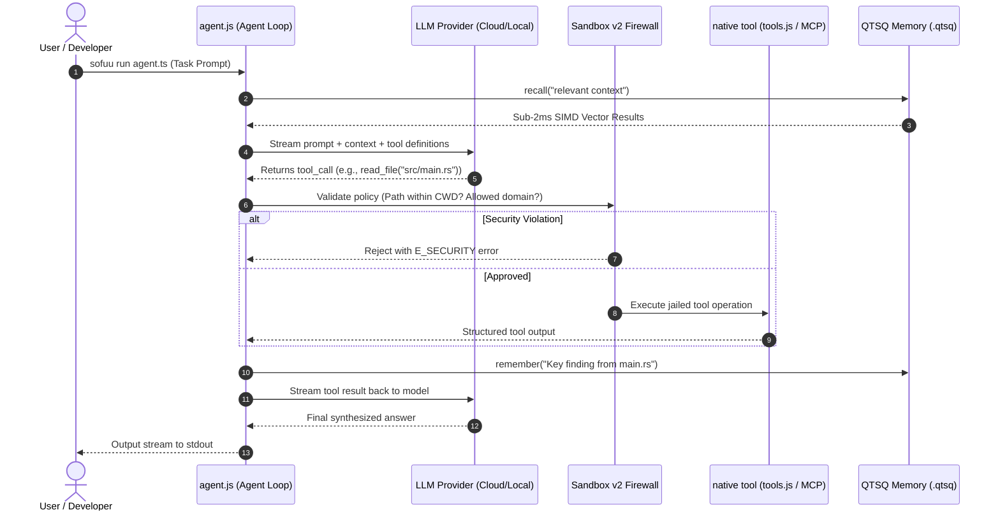

# ⚡ Sofuu Master Architecture Blueprint

> **The Single Source of Truth for Sofuu System Architecture, Subsystems, and Code Navigation.**  
> *Last Updated: October 2026 | Engine Version: 0.3.0-beta*

---

## 1. 🏛️ Executive Philosophy & Core Invariants

Sofuu is **the AI-native general-purpose runtime for JavaScript and TypeScript**. It is designed to collapse the fragmented modern AI stack (Python/Node + LangChain + ChromaDB + Ollama + Redis + FastAPI) into a **single, in-process native executable**.

### The 5 Non-Negotiable Invariants:
1. **The Size Cap ($\le 5.5\text{ MB}$)**: The uncompressed, stripped native binary must never exceed 5.5 MB (currently $\approx 5.2\text{ MB}$ with bundled QTSQ cognitive memory).
2. **Zero External Daemons**: No background Docker containers, no external vector databases, no Python virtual environments.
3. **Sub-4ms Cold Start**: The QuickJS engine and libuv event loop must boot from disk to JavaScript execution in under 4 milliseconds.
4. **Prompt Sovereignty**: The runtime core never injects hidden system prompts, domain biases, or forced telemetry.
5. **Single-Binary Memory & Tools**: Vector embeddings, encrypted episodic memory, sandboxing, and MCP tools live in the same process memory space as the JS engine, eliminating JSON IPC serialization overhead.

---

## 2. 🗺️ Layered System Topology

```mermaid
flowchart TD
    subgraph Layer 4 : User & Application Surfaces
        CLI["CLI Commands (run, chat, dev, infer, repl, bundle)"]
        APPS["User Scripts & Autonomous Agents (TS/JS)"]
        SDK["libsofuu Embeddable C ABI (Swift / Kotlin / iOS / Android)"]
    end

    subgraph Layer 3 : JavaScript Standard Library & Drivers (src/js/)
        AGENT["agent.js (Autonomous Loop & Task-Gate)"]
        TOOLS["tools.js (Jailed Code, Web, Bash, FS Tools)"]
        PLUGINS["plugins.js (5-Shield Plugins & microZod)"]
        PROVIDERS["providers.js (OpenAI / Anthropic / Local Streamer)"]
        MEM_API["memory_api.js (High-Level Vector Brain API)"]
        OBS["observability.js (JSONL Traces & Metrics)"]
    end

    subgraph Layer 2 : Runtime Substrate & Native Bindings (crates/sofuu-core/src/rt/)
        ENGINE["engine.rs (QuickJS Context & Lifecycle)"]
        LOOP["loop.rs (libuv Event Loop & Scheduler)"]
        SANDBOX["sandbox.rs & policy.rs (R7 Sandbox v2 Firewall)"]
        MCP_RT["mcp.rs (Model Context Protocol Client & Server)"]
        HTTP["http_server.rs & http_client.rs (Async HTTP & Fetch)"]
        MEM_RT["memory.rs & brain_store.rs (QTSQ FFI Bridge)"]
        AI_RT["ai.rs (Local & Remote Model Streaming Bridge)"]
    end

    subgraph Layer 1 : Native Engines & Hardware Acceleration
        QJS["QuickJS (ES2023 C Engine)"]
        LIBUV["libuv (Async I/O Event Loop)"]
        QTSQ["libqtsq.a (Encrypted Cognitive Vector Storage)"]
        SIMD["SIMD Kernels (NEON / AVX2 / Metal Compute)"]
        INFER["infer/ (GGUF / SafeTensors Tensor Math Engine)"]
    end

    APPS --> AGENT
    CLI --> ENGINE
    SDK --> ENGINE
    AGENT --> TOOLS
    AGENT --> PROVIDERS
    AGENT --> MEM_API
    TOOLS --> SANDBOX
    PLUGINS --> SANDBOX
    MEM_API --> MEM_RT
    PROVIDERS --> AI_RT
    ENGINE --> QJS
    LOOP --> LIBUV
    MEM_RT --> QTSQ
    AI_RT --> INFER
    MEM_RT --> SIMD
    INFER --> SIMD
```

---

## 3. 🧩 Deep-Dive into Core Subsystems

### 3.1 JavaScript Engine & Event Loop
* **Location:** `crates/sofuu-core/src/rt/engine.rs`, `loop.rs`, `promise.rs`
* **Technologies:** QuickJS (ES2023 standard) + libuv (asynchronous cross-platform I/O).
* **How it works:**
  - QuickJS provides ultra-lightweight, JIT-free JavaScript execution (satisfying iOS App Store constraints by design).
  - libuv manages async timers, file system events, network sockets, child process pipes, and the microtask queue.
  - A cooperative scheduler (`scheduler.yield()`) prevents microtask starvation during heavy agent loops.

### 3.2 Continuous Memory Architecture (CMA v2 / QTSQ)
* **Location:** `crates/sofuu-core/src/memory/`, `crates/sofuu-core/src/rt/memory.rs`, `src/simd/`, `src/js/memory_api.js`
* **File Format:** Encrypted `.qtsq` cognitive container files.
* **How it works:**
  - Provides persistent, on-device episodic and semantic memory.
  - Facts, conversations, and document chunks are converted to vectors (768-dim offline embeddings or remote embeddings).
  - Hardware SIMD kernels (Apple Silicon NEON, x86_64 AVX2) perform cosine similarity, dot product, and L2 distance directly in-process with **sub-2ms recall latency**.
  - Includes portable brain cards (`/share` and `/import`) and optional background compaction.

### 3.3 Autonomous Agent Loop & Task Gate
* **Location:** `src/js/agent.js`, `crates/sofuu-core/src/chat.rs`
* **How it works:**
  - Implements the core autonomous loop: `Prompt` $\rightarrow$ `Model Inference` $\rightarrow$ `Tool Selection` $\rightarrow$ `Sandbox Gate` $\rightarrow$ `Execution` $\rightarrow$ `Memory Update` $\rightarrow$ `Reflection`.
  - Enforces hard token and step budgets (`maxSteps`, `maxTokens`, `timeoutMs`).
  - Generalized session documents support multiple workflows: `chat`, `agent`, `workflow`, and `pipeline`.

### 3.4 Sandbox v2 & 5-Shield Security Firewall
* **Location:** `crates/sofuu-core/src/rt/sandbox.rs`, `policy.rs`, `src/js/tools.js`
* **How it works:**
  - Protects the host machine from rogue or untrusted agent scripts and third-party tools.
  - **Shield 1 (Filesystem Jailing):** Restricts file access strictly to project workspace (`cwd`), rejects directory traversal (`..`), and blocks credential stores (`.ssh`, `.aws`, `.env`, private keys).
  - **Shield 2 (Network Allowlisting):** Enforces strict domain allowlists (e.g., only `api.github.com` or `api.anthropic.com`).
  - **Shield 3 (Command Deny-List):** Catastrophic shell command rejection (`rm -rf /`, fork bombs, raw disk modification).
  - **Shield 4 (Instruction Fuel Metering):** Enforces deterministic execution budgets on script execution.
  - **Shield 5 (Fault Isolation):** Unhandled tool exceptions fail gracefully back into the agent context without crashing the runtime.

### 3.5 Model Context Protocol (MCP)
* **Location:** `crates/sofuu-core/src/rt/mcp.rs`, `crates/sofuu-core/src/mcp/`
* **How it works:**
  - Provides native, zero-dependency client and server implementations of Anthropic's Model Context Protocol.
  - Supports transport over `stdio` and HTTP `Server-Sent Events (SSE)`.
  - Exposes MCP tools directly to `sofuu.agent` with seamless schema conversion.

### 3.6 Local Inference & Tensor Math (Experimental Engine)
* **Location:** `crates/sofuu-core/src/infer/`, `src/metal/`
* **How it works:**
  - In-process parser and runner for **GGUF**, **SafeTensors**, PyTorch `.pt`, and NumPy arrays.
  - GPU compute shaders in Apple Metal (`src/metal/`) for matrix multiplications on Apple Silicon.
  - Built-in KV cache compaction and sliding-window attention for running past token limits.
  - *Strategic Note:* Recommended for experimentation; production local workloads route through `sofuu-plugin-llamacpp`.

### 3.7 Real-Time Session Mesh
* **Location:** `crates/sofuu-core/src/session.rs`, `crates/sofuu-core/src/rt/session_doc.rs`, `session_js.rs`
* **How it works:**
  - Multiple terminal sessions on the same project automatically discover each other over encrypted local IPC.
  - Synchronizes active agent tasks (`/work`, `/done`), shared scratchpad notes, and memory updates in real time.
  - Eliminates the need for external Redis or Kafka instances when coordinating multiple agents.

### 3.8 Observability & Write-Ahead Log (WAL)
* **Location:** `crates/sofuu-core/src/rt/observability.rs`, `wal.rs`, `src/js/observability.js`
* **How it works:**
  - Streams machine-readable `.jsonl` audit traces of every model token, tool execution, and memory read.
  - Crash-resilient write-ahead logging ensures agent state can be resumed exactly where it paused.

### 3.9 ESM Bundler & TypeScript Stripper
* **Location:** `crates/sofuu-core/src/bundler.rs`, `ts.rs`, `crates/sofuu-core/src/rt/bytecode.rs`
* **How it works:**
  - Strips TypeScript type annotations in-memory with zero runtime overhead using a fast lexical scanner (`ts.rs`).
  - Bundles nested ESM import trees into a single self-contained script using `bundler.rs`.
  - Compiles JavaScript directly into AOT QuickJS bytecode for sub-millisecond execution.

---

## 4. 🔄 Core Data & Execution Flows

### Flow 1: Agent Execution & Tool Invocation


### Flow 2: CLI Boot & Command Dispatch
```
$ sofuu <command> [args]
  │
  ├──> crates/sofuu-core/src/main.rs
  │     ├── Check for embedded standalone trailer (SOFUU_BIN_V1)
  │     │     └── [If Match] -> Jump directly to AOT agent bytecode (<0.5ms)
  │     │
  │     └── [Normal CLI Dispatch]
  │           ├── 'chat'    -> chat.rs (Interactive TUI Agent Workspace)
  │           ├── 'run'     -> engine.rs (Evaluate JS/TS file with libuv loop)
  │           ├── 'dev'     -> frontend/ (AI-native dev server & live reload)
  │           ├── 'infer'   -> infer/ (Direct local GGUF CPU/GPU execution)
  │           ├── 'bundle'  -> bundler.rs (Package ESM/TS to single file)
  │           ├── 'doctor'  -> doctor.rs (QTSQ, Metal, SIMD health checks)
  │           └── 'repl'    -> Interactive QuickJS REPL
```

---

## 5. 📂 Repository Navigation Index

| Directory / File | Subsystem | Language | Purpose & Responsibility |
| :--- | :--- | :--- | :--- |
| [`crates/sofuu-core/src/main.rs`](file:///Users/priyanshuboruah/ai-native-js-runtime/crates/sofuu-core/src/main.rs) | CLI / Entry | Rust | CLI parser, command dispatcher, and trailer boot detector. |
| [`crates/sofuu-core/src/rt/`](file:///Users/priyanshuboruah/ai-native-js-runtime/crates/sofuu-core/src/rt/) | Runtime Substrate | Rust | QuickJS bindings, libuv event loop, promises, and OS primitives. |
| [`crates/sofuu-core/src/rt/engine.rs`](file:///Users/priyanshuboruah/ai-native-js-runtime/crates/sofuu-core/src/rt/engine.rs) | JS Engine | Rust | QuickJS context initialization and global variable injections. |
| [`crates/sofuu-core/src/rt/sandbox.rs`](file:///Users/priyanshuboruah/ai-native-js-runtime/crates/sofuu-core/src/rt/sandbox.rs) | Security | Rust | Sandbox v2 filesystem jail, domain firewall, and fuel metering. |
| [`crates/sofuu-core/src/rt/memory.rs`](file:///Users/priyanshuboruah/ai-native-js-runtime/crates/sofuu-core/src/rt/memory.rs) | Memory Bridge | Rust | High-speed bridge between QuickJS and the native QTSQ static library. |
| [`crates/sofuu-core/src/bundler.rs`](file:///Users/priyanshuboruah/ai-native-js-runtime/crates/sofuu-core/src/bundler.rs) | Bundler | Rust | Zero-dependency ESM dependency graph resolver and tree-shaker. |
| [`crates/sofuu-core/src/ts.rs`](file:///Users/priyanshuboruah/ai-native-js-runtime/crates/sofuu-core/src/ts.rs) | TypeScript | Rust | Instant lexical TypeScript type stripper (no tsc required). |
| [`crates/sofuu-core/src/chat.rs`](file:///Users/priyanshuboruah/ai-native-js-runtime/crates/sofuu-core/src/chat.rs) | Terminal UX | Rust | Terminal UI, streaming markdown renderer, and prompt manager. |
| [`crates/sofuu-core/src/infer/`](file:///Users/priyanshuboruah/ai-native-js-runtime/crates/sofuu-core/src/infer/) | Local Inference | Rust/C | GGUF/SafeTensors parser, tensor operations, and KV cache manager. |
| [`crates/sofuu-capi/`](file:///Users/priyanshuboruah/ai-native-js-runtime/crates/sofuu-capi/) | C ABI SDK | Rust/C | Embeddable `libsofuu` interface for iOS, Android, Swift, and Kotlin. |
| [`src/js/agent.js`](file:///Users/priyanshuboruah/ai-native-js-runtime/src/js/agent.js) | Agent Framework | JS | Multi-step agent loops, task gates, budgets, and reflection. |
| [`src/js/tools.js`](file:///Users/priyanshuboruah/ai-native-js-runtime/src/js/tools.js) | Standard Tools | JS | Built-in coding tools (`read_file`, `edit_file`, `bash`, `grep`, `glob`). |
| [`src/js/plugins.js`](file:///Users/priyanshuboruah/ai-native-js-runtime/src/js/plugins.js) | Plugins & Schemas | JS | 5-Shield plugin architecture, `defineTool`, and `microZod` (`z`). |
| [`src/js/providers.js`](file:///Users/priyanshuboruah/ai-native-js-runtime/src/js/providers.js) | Model Streaming | JS | Unified streaming over OpenAI, Anthropic, Gemini, Groq, and custom APIs. |
| [`src/js/memory_api.js`](file:///Users/priyanshuboruah/ai-native-js-runtime/src/js/memory_api.js) | Memory Interface | JS | High-level `sofuu.memory` API for reading/writing `.qtsq` files. |
| [`src/simd/`](file:///Users/priyanshuboruah/ai-native-js-runtime/src/simd/) | Hardware SIMD | C / Assembly | Vector math (cosine, dot, L2, quantization) for ARM NEON and x86 AVX2. |
| [`src/metal/`](file:///Users/priyanshuboruah/ai-native-js-runtime/src/metal/) | GPU Acceleration | Metal | Apple Silicon Metal compute shaders for fast local tensor matmul. |
| [`sofuu-landing/`](file:///Users/priyanshuboruah/ai-native-js-runtime/sofuu-landing/) | Web & Docs | Next.js / React | Official documentation site, landing page, and developer portal (`sofuu.xyz`). |

---

## 6. 🛡️ Safe Modification Guidelines (For AI Agents & Developers)

Whenever modifying or extending the Sofuu codebase, you **must adhere to these rules**:

1. **Preserve Stripped Size Cap**: Never introduce large third-party crates (like heavy regex engines or multi-megabyte parsing libraries) that push the release binary over 5.5 MB.
2. **Bytecode Sync Rule**: If you edit any driver in `src/js/*.js` (e.g. `agent.js` or `tools.js`), you must re-generate its corresponding `.bc` and `.bc.gz` bytecode snapshots (`make bc-check` verifies this).
3. **No Unhandled Panics in FFI**: Every Rust function exposed to QuickJS must catch errors and return a `JS_ThrowError` instead of using `.unwrap()` or panic.
4. **Preserve Sandbox Boundaries**: Tools must never bypass lexical path canonicalization (`src/js/tools.js` and `crates/sofuu-core/src/rt/sandbox.rs`).
5. **No Model Weight Downloads**: Tests, CI, and benchmarks must use existing fixtures (`contract/fixtures/sofuu-fixture.gguf`) or mock backends; never trigger internet downloads of LLM weights.
