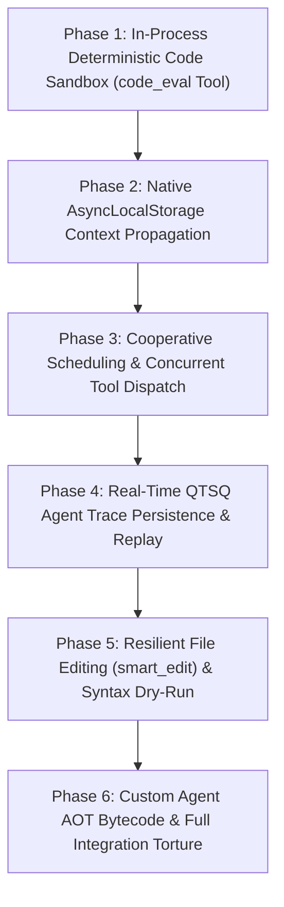

# Master Architectural Plan: Sofuu Autonomous Agent Loop & Shipped JavaScript Drivers Modernization

> **Document:** `docs/PLAN-AUTONOMOUS-AGENT-LOOP-AND-DRIVERS.md`  
> **Author:** Haruhito  
> **Target:** Sofuu AI-Native Edge JavaScript Runtime (`ai-native-js-runtime`)  
> **Objective:** Upgrade and harden Sofuu's autonomous agent loop (`agent.js`, `chat.js`, `tools.js`, `web.js`) with in-process deterministic sandboxing, zero-plumbing context propagation, cooperative multitasking, real-time QTSQ trace streaming, and resilient editing.

---

## 1. Architectural Vision & Invariants

Sofuu is engineered as the lightweight, embeddable "SQLite of AI Agents & Edge Inference".
While conventional agent frameworks (LangChain, AutoGen, CrewAI) rely on bulky Python dependencies, separate background processes, and unconstrained shell execution, Sofuu executes its **complete autonomous agent loop in-process inside QuickJS**, compiled into **AOT bytecode** (`agent.bc`, `chat.bc`, `tools.bc`, `web.bc`, `storage.bc`, `extractor.bc`, `rlm.bc`) with sub-16ms engine cold starts.

```
                   MODERNIZED AUTONOMOUS AGENT ARCHITECTURE
                   
  ┌────────────────────────────────────────────────────────────────────────┐
  │ Host Surfaces: macOS SwiftUI IDE • Android Compose • CLI TUI • C-ABI   │
  └──────────────────────────────────┬─────────────────────────────────────┘
                                     │ sofuu.agent.run / sofuu chat
  ┌──────────────────────────────────▼─────────────────────────────────────┐
  │ 1. Cooperative Agent Loop (src/js/agent.js)                            │
  │    • W3C scheduler.yield() Step Pacing   • AsyncLocalStorage Context   │
  │    • Parallel Tool Execution Pools       • Sub-Agent "Agents-as-Tools" │
  │    • FNV-1a Token Reuse Ledger           • Dynamic Fuel & Token Caps   │
  ├────────────────────────────────────────────────────────────────────────┤
  │ 2. Deterministic Sandboxed Tools (src/js/tools.js)                     │
  │    • In-Process code_eval Scratchpad     • Single-Instruction Fuel Meter│
  │    • Hermetic Isolation (< 1ms startup)  • Wall-Clock Interrupt Deadlines│
  ├────────────────────────────────────────────────────────────────────────┤
  │ 3. Resilient File Editing & Syntactic Dry-Run                          │
  │    • Whitespace-Insensitive Fallback     • Syntax Validation Gate      │
  │    • Bounded Numbered Unified Diffs      • Sensitive File Redaction    │
  ├────────────────────────────────────────────────────────────────────────┤
  │ 4. Real-Time QTSQ Trace Streaming (src/js/storage.js)                  │
  │    • Append-Only Encrypted Trace Stream  • Zero-Data-Loss Crash Resume │
  │    • Time-Travel Replay & Inspection     • Sub-Millisecond Pagination  │
  ├────────────────────────────────────────────────────────────────────────┤
  │ 5. Custom Agent AOT Bytecode Acceleration                              │
  │    • Automatic compile-bc on loadDir     • Sub-Millisecond Swarm Start │
  └────────────────────────────────────────────────────────────────────────┘
```

### Strict Architectural Invariants
1. **Binary Size Budget**: Stripped release binary must remain strictly $\le 5.0\text{ MB}$ (current: 4.8 MB; budget headroom: 200 KB).
2. **Inference Isolation**: All modifications remain strictly confined to shipped JS drivers (`src/js/`) and runtime substrate interfaces (`crates/sofuu-core/src/rt/`, `crates/sofuu-ffi/`), never modifying inference kernels (`metal.rs`, `simd/infer_kernels.cpp`).
3. **Deterministic Safety**: Dynamic code execution by agents must never run with unconstrained host privileges when sandboxed execution is applicable.
4. **Zero Event-Loop Lockup**: Deep multi-step agent trajectories and multi-agent map-reduces must never freeze the libuv I/O loop or host UI threads.
5. **Developer WIP Preservation**: Leave unstaged working tree changes in `sofuu-android/` and `sofuu-macos/` untouched.

---

## 2. Phase-by-Phase Implementation Roadmap



---

### Phase 1: In-Process Deterministic Code Sandbox (`code_eval` Tool)
- **Problem**: When agents need to perform math, format JSON, or compute intermediate logic, they currently invoke `bash`, which takes 20–50 ms to fork a subprocess, requires Node/Python installed on the host, and has unconstrained OS access unless restricted.
- **Deliverables**:
  - Implement `code_eval` tool in `src/js/tools.js` powered directly by `sofuu.sandbox.run(code, opts)`.
  - Default execution bounds:
    - `fuelLimit`: 500,000 instructions (determines termination deterministically).
    - `timeoutMs`: 2,000 ms wall-clock interrupt deadline.
    - `maxMemoryBytes`: 16 MB physical allocation limit.
    - `captureConsole`: true (captures `console.log`, `info`, `warn`, `error` into structured log array).
  - Return shape:
    ```javascript
    {
      success: true,
      result: <evaluated_value>,
      logs: ["stdout line 1", "stdout line 2"],
      fuelUsed: 1420,
      elapsedMs: 0.42
    }
    ```
  - Graceful trap handling: Return clean descriptive error objects (`{ success: false, error: "Fuel limit exceeded", errorType: "fuel" }`) so the LLM self-corrects without crashing the turn.
  - Mount `code_eval` in `sofuu.tools.TOOLS` and include in default `code` toolgroup.
- **Verification**: `tests/test_agent_code_eval.js`:
  - Verify mathematical calculations and data transformations run in $< 1\text{ ms}$.
  - Verify infinite loops (`while(true){}`) terminate deterministically with fuel exhaustion.
  - Verify memory bombs (`while(true) [].push(...)`) are caught by the 16 MB ceiling.
  - Verify zero access to host globals (`sofuu.fs`, `process.exit`, `fetch` are undefined).

---

### Phase 2: Native Context Propagation via `AsyncLocalStorage` (`sofuu.context`)
- **Problem**: `agent.js` manually passes cancellation state, run ID, chain history, tree token counters, and depth across dozens of internal helper functions and asynchronous callbacks.
- **Deliverables**:
  - Wrap `sofuu.agent.run()` in `sofuu.context.run(store, async () => { ... })`:
    - Store payload: `{ runId, agentName, depth, chain, traceId, sessionId, signal, budget }`.
  - Expose `sofuu.agent.current()` reading active context from `sofuu.context.get()`.
  - Eliminate manual parameter threading across `execOneTool`, `execDelegate`, and sub-agent invocations.
  - Wire native `AbortSignal` listener: when `signal.abort()` fires, all active in-flight tool promises, HTTP fetches, and child sub-agents cancel immediately.
- **Verification**: `tests/test_agent_context_propagation.js`:
  - Verify context is preserved across deep async chains, microtasks, timers, and native file I/O.
  - Verify concurrent parallel agent runs have zero crosstalk between their respective contexts.
  - Verify abort signal cancellation cascades instantaneously through sub-agents.

---

### Phase 3: Cooperative Scheduling & Concurrent Tool Dispatch
- **Problem**: Heavy multi-step agent trajectories (30+ steps) or parallel sub-agent fan-out can monopolize the microtask queue, starving the libuv event loop and freezing host UI threads.
- **Deliverables**:
  - **Cooperative Step Yielding**: Insert `await (globalThis.scheduler ? scheduler.yield() : sofuu.yield())` at the top of each agent step in `agent.js` and between iterations in `mapContext` / `runMany`.
  - **Parallel Tool Execution**: When the LLM outputs multiple tool calls in a single turn (e.g. reading 4 files or executing multiple searches):
    - Partition tools into parallelizable (read-only tools: `read_file`, `grep`, `glob`, `list_dir`, `web_search`, `code_eval`) vs sequential (mutating tools: `write_file`, `edit_file`, `bash`).
    - Dispatch parallelizable tools concurrently using `Promise.allSettled()` with bounded concurrency ($N=4$).
    - Cuts multi-tool turn latency from $\sim 120\text{ ms}$ to $\sim 30\text{ ms}$.
- **Verification**: `tests/test_agent_concurrency_yield.js`:
  - Benchmark parallel vs sequential tool dispatch (demonstrating $\ge 3\text{x}$ throughput improvement on multi-read turns).
  - Verify timer ticks fire reliably during heavy multi-turn agent runs with zero UI freezing.

---

### Phase 4: Real-Time QTSQ Agent Trace Persistence & Replay
- **Problem**: Agent traces are stored in a transient in-memory array (`trace = []`) and pruned via `TRACE_CAP`. If the host app crashes, turns and tool outputs cannot be recovered.
- **Deliverables**:
  - Connect agent trace emission directly to encrypted `storage.qtsq` under `sdb.traces`:
    - Table schema: `run_id`, `step_index`, `timestamp`, `kind`, `tool_name`, `input_json`, `output_json`, `duration_ms`, `tokens`.
    - Real-time append: Every thought, tool call, and result streams to disk immediately.
  - Implement `sofuu.agent.getTrace(runId)`: Fast selective retrieval of any historical agent trace with sub-millisecond reverse pagination.
  - Implement `sofuu.agent.resume(runId)`: Reconstructs state from `storage.qtsq` and continues execution from the last uncompleted step.
- **Verification**: `tests/test_agent_qtsq_trace.js`:
  - Interleave 100 agent steps while verifying live persistence to `storage.qtsq`.
  - Simulate process crash mid-run and verify full state recovery and historical trace retrieval.

---

### Phase 5: Resilient File Editing (`smart_edit`) & Syntax Dry-Run
- **Problem**: `edit_file` in `tools.js` relies on strict literal string matching. If an LLM introduces minor indentation or whitespace variations, the edit fails, burning tokens and steps on retry apologies.
- **Deliverables**:
  - **Whitespace-Tolerant Fallback**: If an exact literal match fails:
    - Attempt indentation-normalized line matching (ignoring leading/trailing whitespace differences).
    - If a unique match is found, apply the edit cleanly while preserving original file indentation style.
  - **Syntax Dry-Run Gate**: Before writing the modified text to disk:
    - For `.js`, `.ts`, `.json` files, pass the replacement candidate through QuickJS parser (`sofuu.parse(code)`).
    - If a syntax error is detected, reject the edit with a precise compiler error message (`SyntaxError: Unexpected token on line 42`) without corrupting the file on disk.
  - **Unified Diff Generation**: Continue stashing bounded, numbered unified diffs in `globalThis.__sofuu_last_diff` for live GUI display.
- **Verification**: `tests/test_agent_smart_edit.js`:
  - Test literal matches, whitespace-tolerant fallback matches, and rejection of ambiguous non-unique matches.
  - Test syntax dry-run catching intentional syntax errors before disk writes.

---

### Phase 6: Custom Agent AOT Bytecode & Full Integration Torture Suite
- **Deliverables**:
  - Extend `sofuu.agent.loadDir(dir)` to automatically precompile custom agent scripts (`~/.sofuu/agents/*.js`) into `.bc` bytecode snapshots using `sofuu compile-bc`.
  - Recompile all shipped drivers into updated bytecode snapshots:
    `sofuu compile-bc src/js/agent.js src/js/agent.bc`
    `sofuu compile-bc src/js/tools.js src/js/tools.bc`
    `sofuu compile-bc src/js/chat.js src/js/chat.bc`
  - Authored comprehensive torture test `tests/test_agent_modernization_torture.js` executing 50 concurrent agent runs combining all 5 modernization tracks.
  - Release binary budget verification strictly $\le 5.0\text{ MB}$.
  - OpenQodex code review gate execution and clean git push.
