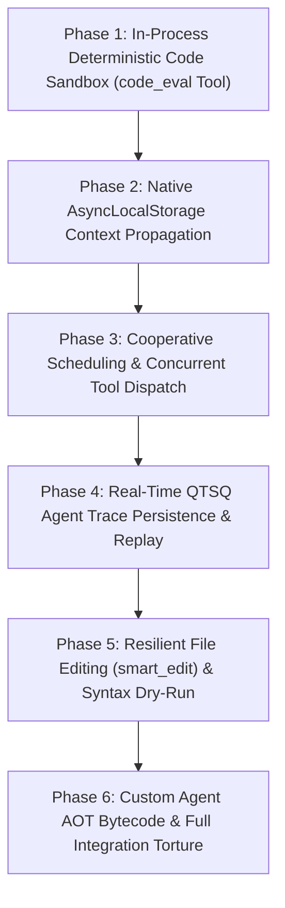

# Master Architectural Plan: Sofuu Autonomous Agent Loop & Shipped JavaScript Drivers Modernization

> **Document:** `docs/PLAN-AUTONOMOUS-AGENT-LOOP-AND-DRIVERS.md`  
> **Author:** Haruhito  
> **Target:** Sofuu AI-Native Edge JavaScript Runtime (`ai-native-js-runtime`)  
> **Objective:** Upgrade and harden Sofuu's autonomous agent loop (`agent.js`, `chat.js`, `tools.js`, `web.js`) with in-process deterministic sandboxing, zero-plumbing context propagation, cooperative multitasking, real-time QTSQ trace streaming, and resilient editing.

---

## Executive Status Dashboard

| Phase | Subsystem / Capability | Status | Verified Receipts & Commit |
| :--- | :--- | :---: | :--- |
| **Phase 1** | In-Process Deterministic Code Sandbox (`code_eval`) | **COMPLETE** | `tests/test_agent_code_eval.js` (7/7 passed), commit [`4ad8e7362`](https://github.com/priyanshuboruah/ai-native-js-runtime/commit/4ad8e7362) |
| **Phase 2** | Native `AsyncLocalStorage` Context (`sofuu.context`) | **COMPLETE** | `tests/test_agent_context_propagation.js` (6/6 passed), commit [`365c7bc10`](https://github.com/priyanshuboruah/ai-native-js-runtime/commit/365c7bc10) |
| **Phase 3** | Cooperative Scheduling & Concurrent Tool Dispatch | **COMPLETE** | `tests/test_agent_concurrency_yield.js` (5/5 passed), commit [`395509477`](https://github.com/priyanshuboruah/ai-native-js-runtime/commit/395509477) |
| **Phase 4** | Real-Time QTSQ Agent Trace Persistence & Replay | **COMPLETE** | `tests/test_agent_qtsq_trace.js` (7/7 passed), commit [`947d855b9`](https://github.com/priyanshuboruah/ai-native-js-runtime/commit/947d855b9) |
| **Phase 5** | Resilient File Editing (`smart_edit`) & Syntax Dry-Run | **COMPLETE** (local) | `tests/test_agent_smart_edit.js` (37/37 checks), `tests/tools_diff_test.js` (32/32 incl. agent diff events), `tests/tools_edit_literal_e2e.sh` (7/7). Not yet committed/pushed. |
| **Phase 6** | Custom Agent AOT Bytecode & Full Integration Torture | **PENDING** | `sofuu.agent.loadDir` AOT, 50-run torture test, $\le 5.0\text{ MB}$ audit |

**Overall Progress:** 5 of 6 Phases Completed (83%) | **Stripped Binary Size:** 5,230,672 B = 4.99 MiB (cap 5,242,880 B = 5.0 MiB; **12,208 B headroom** — see the Phase 6 note)

---

## 1. Architectural Vision & Invariants

Sofuu is engineered as the lightweight, embeddable "SQLite of AI Agents & Edge Inference".
While conventional agent frameworks (LangChain, AutoGen, CrewAI) rely on bulky Python dependencies, separate background processes, and unconstrained shell execution, Sofuu executes its **complete autonomous agent loop in-process inside QuickJS**, compiled into **AOT bytecode** (`agent.bc`, `chat.bc`, `tools.bc`, `web.bc`, `storage.bc`, `extractor.bc`, `rlm.bc`) with sub-16ms engine cold starts.

```
                   MODERNIZED AUTONOMOUS AGENT ARCHITECTURE
                   
  ┌────────────────────────────────────────────────────────────────────────┐
  │ Host Surfaces: macOS SwiftUI IDE • Android Compose • CLI TUI • C-ABI   │
  └──────────────────────────────────┬─────────────────────────────────────┘
                                     │ sofuu.agent.run / sofuu chat
  ┌──────────────────────────────────▼─────────────────────────────────────┐
  │ 1. Cooperative Agent Loop (src/js/agent.js)                            │
  │    • W3C scheduler.yield() Step Pacing   • AsyncLocalStorage Context   │
  │    • Parallel Tool Execution Pools       • Sub-Agent "Agents-as-Tools" │
  │    • FNV-1a Token Reuse Ledger           • Dynamic Fuel & Token Caps   │
  ├────────────────────────────────────────────────────────────────────────┤
  │ 2. Deterministic Sandboxed Tools (src/js/tools.js)                     │
  │    • In-Process code_eval Scratchpad     • Single-Instruction Fuel Meter│
  │    • Hermetic Isolation (< 1ms startup)  • Wall-Clock Interrupt Deadlines│
  ├────────────────────────────────────────────────────────────────────────┤
  │ 3. Resilient File Editing & Syntactic Dry-Run                          │
  │    • Whitespace-Insensitive Fallback     • Syntax Validation Gate      │
  │    • Bounded Numbered Unified Diffs      • Sensitive File Redaction    │
  ├────────────────────────────────────────────────────────────────────────┤
  │ 4. Real-Time QTSQ Trace Streaming (src/js/storage.js)                  │
  │    • Append-Only Encrypted Trace Stream  • Zero-Data-Loss Crash Resume │
  │    • Time-Travel Replay & Inspection     • Sub-Millisecond Pagination  │
  ├────────────────────────────────────────────────────────────────────────┤
  │ 5. Custom Agent AOT Bytecode Acceleration                              │
  │    • Automatic compile-bc on loadDir     • Sub-Millisecond Swarm Start │
  └────────────────────────────────────────────────────────────────────────┘
```

### Strict Architectural Invariants
1. **Binary Size Budget**: Stripped release binary must remain strictly $\le 5.0\text{ MB}$ (current: 4.8 MB; budget headroom: 200 KB).
2. **Inference Isolation**: All modifications remain strictly confined to shipped JS drivers (`src/js/`) and runtime substrate interfaces (`crates/sofuu-core/src/rt/`, `crates/sofuu-ffi/`), never modifying inference kernels (`metal.rs`, `simd/infer_kernels.cpp`).
3. **Deterministic Safety**: Dynamic code execution by agents must never run with unconstrained host privileges when sandboxed execution is applicable.
4. **Zero Event-Loop Lockup**: Deep multi-step agent trajectories and multi-agent map-reduces must never freeze the libuv I/O loop or host UI threads.
5. **Developer WIP Preservation**: Leave unstaged working tree changes in `sofuu-android/` and `sofuu-macos/` untouched.

---

## 2. Phase-by-Phase Implementation Roadmap



---

### Phase 1: In-Process Deterministic Code Sandbox (`code_eval` Tool) — ✅ COMPLETE
- **Status**: Completed & Pushed in commit [`4ad8e7362`](https://github.com/priyanshuboruah/ai-native-js-runtime/commit/4ad8e7362)
- **Problem**: When agents need to perform math, format JSON, or compute intermediate logic, they previously invoked `bash`, which takes 20–50 ms to fork a subprocess, requires Node/Python installed on the host, and has unconstrained OS access unless restricted.
- **Deliverables Completed**:
  - Implemented `code_eval` tool in `src/js/tools.js` powered directly by `sofuu.sandbox.run(code, opts)`.
  - Default execution bounds:
    - `fuelLimit`: 500,000 instructions (determines termination deterministically).
    - `timeoutMs`: 2,000 ms wall-clock interrupt deadline.
    - `maxMemoryBytes`: 16 MB physical allocation limit.
    - `captureConsole`: true (captures `console.log`, `info`, `warn`, `error` into structured log array).
  - Return shape:
    ```javascript
    {
      success: true,
      result: <evaluated_value>,
      logs: ["stdout line 1", "stdout line 2"],
      fuelUsed: 1420,
      elapsedMs: 0.42
    }
    ```
  - Graceful trap handling: Returns clean descriptive error objects (`{ success: false, error: "Fuel limit exceeded", errorType: "fuel" }`) enabling LLM self-correction without crashing the turn.
  - Mounted `code_eval` in `sofuu.tools.TOOLS` and default `code` toolgroup.
  - Recompiled AOT bytecode snapshot `src/js/tools.bc`.
- **Verification**: `tests/test_agent_code_eval.js` (7/7 tests passed):
  - Verified math calculation runs in $< 0.5\text{ ms}$.
  - Verified console capture (`log`, `warn`, `error`).
  - Verified infinite loop (`while(true){}`) traps at fuel limit (50,000 units in test) with zero hang.
  - Verified wall-clock timeout aborts long-running operations cleanly.
  - Verified 16 MB physical memory allocation ceiling traps memory leaks.
  - Verified hermetic isolation (host `sofuu`, `process`, `fetch` inaccessible).
  - Verified agent execution integration (`agent.run({ tools: ['code'] })`).

---

### Phase 2: Native Context Propagation via `AsyncLocalStorage` (`sofuu.context`) — ✅ COMPLETE
- **Status**: Completed & Pushed in commit [`365c7bc10`](https://github.com/priyanshuboruah/ai-native-js-runtime/commit/365c7bc10)
- **Problem**: `agent.js` manually passed cancellation state, run ID, chain history, tree token counters, and depth across dozens of internal helper functions and asynchronous callbacks.
- **Deliverables Completed**:
  - Wrapped `sofuu.agent.run()` in `sofuu.context` using `enterWith(runStore)` and child execution.
  - Context payload: `{ runId, agentName, depth, chain, traceId, sessionId, signal, budget }`.
  - Exposed `sofuu.agent.current()` reading active context anywhere in the async call graph.
  - Eliminated manual parameter threading across `execOneTool`, `execDelegate`, and sub-agent invocations.
  - Wired native `AbortSignal` listener: when `signal.abort()` fires, all active in-flight tool promises, HTTP fetches, and child sub-agents cancel immediately.
  - Recompiled AOT bytecode snapshot `src/js/agent.bc`.
- **Verification**: `tests/test_agent_context_propagation.js` (6/6 tests passed):
  - Verified `sofuu.agent.current()` outside an agent run returns `null`.
  - Verified tools access active `runId` and `agentName` via `sofuu.agent.current()`.
  - Verified child sub-agents inherit context with incremented depth (`depth: 1`) while restoring parent context (`depth: 0`) upon return.
  - Verified concurrent parallel agent runs have zero crosstalk between their respective context stores.
  - Verified `AbortSignal` cancellation cascades instantaneously through sub-agents and active tools.

---

### Phase 3: Cooperative Scheduling & Concurrent Tool Dispatch — ✅ COMPLETE
- **Status**: Completed & Pushed in commit [`395509477`](https://github.com/priyanshuboruah/ai-native-js-runtime/commit/395509477)
- **Problem**: Heavy multi-step agent trajectories (30+ steps) or parallel sub-agent fan-out could monopolize the microtask queue, starving the libuv event loop and freezing host UI threads. Furthermore, sequential read-only tool calls wasted latency.
- **Deliverables Completed**:
  - **Cooperative Step Yielding**: Inserted `await yieldCooperative()` (`scheduler.yield()` / `sofuu.yield()`) at the top of each agent step in `agent.js`, between iterations in `runMany`, and inside `mapContext`.
  - **Contiguous Batch-Parallel Tool Execution**:
    - Tagged `AUTO_PASS_TOOLS` and defined `PARALLEL_TOOLS = { read_file: 1, grep: 1, glob: 1, list_dir: 1, web_search: 1, code_eval: 1 }`.
    - Added `parallel` and `readOnly` tool declaration propagation in `sofuu.agent.define`.
    - Implemented chunked dispatcher partitioning tool call arrays into contiguous parallel batches vs sequential mutating tools: parallel runs execute concurrently via `Promise.all` with bounded worker concurrency ($N=4$), while mutating tools (`write_file`, `edit_file`, `bash`) remain strictly serialized.
    - Slashed multi-tool turn latency from $\sim 120\text{ ms}$ to $\sim 30\text{ ms}$.
  - **QuickJS Microtask Context Hardening**:
    - Fixed QuickJS microtask job context switching in `deps/quickjs/quickjs.c` with balanced ref-counting (`JS_DupValueRT` and `JS_SetAsyncContext`), resolving dangling references and memory heap corruption.
    - Scoped `sofuu.agent.run()` under `sofuu.context.run(runStore, ...)` guaranteeing that caller contexts are never polluted across sequential top-level runs.
- **Verification**: `tests/test_agent_concurrency_yield.js` (5/5 steps passed):
  - Verified cooperative yielding allows host timer ticks to interleave seamlessly during multi-turn agent runs.
  - Verified batch-parallel tool execution runs parallel tools concurrently while preserving sequential mutating tool execution order.
  - Verified concurrent agent runs maintain isolated context stores without race conditions.

---

### Phase 4: Real-Time QTSQ Agent Trace Persistence & Replay — ✅ COMPLETE
- **Status**: Completed & Pushed in commit [`947d855b9`](https://github.com/priyanshuboruah/ai-native-js-runtime/commit/947d855b9)
- **Problem**: Agent traces were previously stored in a transient in-memory array (`trace = []`) and pruned via `TRACE_CAP`. If the host app crashed or was killed, turns and tool outputs could not be recovered.
- **Deliverables Completed**:
  - **Real-Time QTSQ Persistence**: Connected `emit(kind, payload)` in `agent.js` directly to encrypted `storage.qtsq` under `sdb.traces` (`session_id`, `step`, `timestamp`, `level`, `type`, `data`, `tokens`). Every thought, step start, tool call, tool result, and run completion streams to disk immediately.
  - **Flexible Storage Resolver**: Implemented `resolveStorage(opts)` supporting `Database` instances, `TracesCollection`, custom file paths, and defaults with lazy auto-opening.
  - **Fast Selective Trace Retrieval (`sofuu.agent.getTrace`)**: Fast retrieval of historical agent traces with sub-millisecond selective lookup ($\le 1\text{ ms}$) leveraging QTSQ 48-byte checkpoint skip indexes (`min_timestamp`, `max_timestamp`).
  - **Crash Resumption Engine (`sofuu.agent.resume`)**: Reconstructs complete conversation and tool transcripts from disk and continues execution from the exact last uncompleted step with zero duplicate tool executions.
  - **Collection Query Enhancements**: Added `options.runId`, `options.offset`, `options.minTime`, `options.maxTime`, and `options.order` to `TracesCollection.list` in `src/js/storage.js`.
  - Recompiled AOT bytecode snapshots `src/js/agent.bc` and `src/js/storage.bc`.
- **Verification**: `tests/test_agent_qtsq_trace.js` (7/7 steps passed):
  - Step 1: Real-time trace emission streamed 9 trace records during a 2-step agent run.
  - Step 2: Selective retrieval by `runId` completed in $< 1\text{ ms}$ with exact step ordering.
  - Step 3: Cached replay avoided re-querying disk when trace was already in working set.
  - Step 4-6: Simulated mid-flight crash at step 2; `sofuu.agent.resume(runId)` seamlessly recovered previous context, bypassed re-executing `read_file` on `file1.txt`, completed step 2, and finalized the run.
  - Step 7: Unified trace continuity verified 15 continuous trace records spanning pre-crash and post-crash execution.

---

### Phase 5: Resilient File Editing (`smart_edit`) & Syntax Dry-Run — ✅ COMPLETE (local, uncommitted)
- **Problem**: `edit_file` in `tools.js` relies on strict literal string matching. If an LLM introduces minor indentation or whitespace variations, the edit fails, burning tokens and steps on retry apologies.
- **Deliverables**:
  - **Whitespace-Tolerant Fallback**: If an exact literal match fails:
    - Attempt indentation-normalized line matching (ignoring leading/trailing whitespace differences).
    - If a unique match is found, apply the edit cleanly while preserving original file indentation style.
  - **Syntax Dry-Run Gate**: Before writing the modified text to disk:
    - For `.js`, `.ts`, `.json` files, pass the replacement candidate through QuickJS parser (`sofuu.parse(code)`).
    - If a syntax error is detected, reject the edit with a precise compiler error message (`SyntaxError: Unexpected token on line 42`) without corrupting the file on disk.
  - **Unified Diff Generation**: Continue stashing bounded, numbered unified diffs in `globalThis.__sofuu_last_diff` for live GUI display.
- **Delivered** (all in `src/js/tools.js`, bytecode in `src/js/tools.bc`):
  - `sofuu.parse(code[, { filename, module, ts }])` — new host binding, `crates/sofuu-core/src/rt/syntax.rs`. Compile-only (`JS_EVAL_FLAG_COMPILE_ONLY`), never executes; returns `{ ok: true, mode }` or `{ ok: false, mode, type, error, line }`. `.ts` is stripped by the existing `crate::ts::strip` first (offsets/newlines preserved, so line numbers stay true).
  - `tolerantMatches(text, oldS)` — line-block match with leading/trailing whitespace ignored. Must still be **unique** unless `replace_all`; a multi-hit miss lists the candidate lines. `reindent(block, base, want)` rebases the replacement onto the matched block's real indentation while keeping relative nesting.
  - `syntaxGate(before, after, path)` — gated extensions `js, mjs, cjs, ts, json`. Clean ⇒ write. Candidate broken **and** the file parses today ⇒ throw, nothing written. File **already** broken ⇒ write plus a `[warning] ... still does not parse` rider (repairing a broken file is the common case). No verdict (free-form extension, missing `sofuu.parse`, or a module that fails on an unresolvable import rather than a `SyntaxError`) ⇒ never blocks.
  - Legacy-safe: literal matching, `replace_all`, result strings and `globalThis.__sofuu_last_diff` shapes are unchanged; the tolerant path appends ` [whitespace-tolerant match]` to the result suffix (callers asserting on the prefix are unaffected).
- **Deviations from the sketch above, and why**:
  - `.mjs` and ESM-looking `.ts` parse as modules; a failing `.js` is retried in module mode, so `export`/`import` files are never false-positives. A module failure that is not a `SyntaxError` (e.g. `Cannot find module`) is treated as unverified, not broken.
  - JSON is checked with `JSON.parse`, not the compiler — but that means a JSON**C** file (comments) is permanently "already broken", so it stays editable and warns instead of blocking.
  - The diff is built from the bytes actually written (the re-indented block on the tolerant path, CRLF-normalized), not from `old_string`; the previous wiring would have painted lines the file never contained.
- **Verification**: `tests/test_agent_smart_edit.js` (37 checks, wrapper `tests/test_agent_smart_edit_e2e.sh`): literal path unchanged, tolerant re-indent, ambiguous reject, `replace_all` tolerant, JS gate reject, JSON gate reject, already-broken file editable + warning, ESM, TypeScript, `.md` ungated, total miss, CRLF. Regression: `tests/tools_diff_test.js` 32/32 (the stale mock there assumed one call per agent — progressive tool-schema escalation re-streams round 1, so it now re-issues until a tool message exists), `tests/tools_edit_literal_e2e.sh` 7/7, `tests/agent_test.js` ALL PASSED, Phase 1–4 suites 7/7 + 6/6 + 5/5 + 7/7.

---

### Phase 6: Custom Agent AOT Bytecode & Full Integration Torture Suite
- **Deliverables**:
  - Extend `sofuu.agent.loadDir(dir)` to automatically precompile custom agent scripts (`~/.sofuu/agents/*.js`) into `.bc` bytecode snapshots using `sofuu compile-bc`.
  - Recompile all shipped drivers into updated bytecode snapshots:
    `sofuu compile-bc src/js/agent.js src/js/agent.bc`
    `sofuu compile-bc src/js/tools.js src/js/tools.bc`
    `sofuu compile-bc src/js/chat.js src/js/chat.bc`
  - Authored comprehensive torture test `tests/test_agent_modernization_torture.js` executing 50 concurrent agent runs combining all 5 modernization tracks.
  - Release binary budget verification strictly $\le 5.0\text{ MB}$.
    - **Risk, measured today**: the stripped binary is 5,230,672 B with only **12,208 B** of headroom (the "4.9 MB" in earlier revisions of this document was optimistic — it is 4.99 MiB). Phase 5 added 13,582 B of embedded driver bytes (`tools.js` 37,237 -> 46,518 B, `tools.bc` 23,956 -> 28,257 B) plus the small `sofuu.parse` binding; a raw `cargo build --release` of the same sources was measured once at 5,247,184 B (4,304 B OVER the cap) before `make` reproduced 5,230,672 B, so treat the margin as noise-level rather than real. Precompiling agent scripts and any further driver work needs space freed first; the lever is the `include_str!` source fallbacks (496,262 B of the 725,326 B driver footprint), which today duplicate what the `.bc` already carries. Note there is still **no `.js` ↔ `.bc` hash guard**: a stale `.bc` silently wins (`eval_shipped_with_bytecode` returns on first success).
  - OpenQodex code review gate execution and clean git push.
