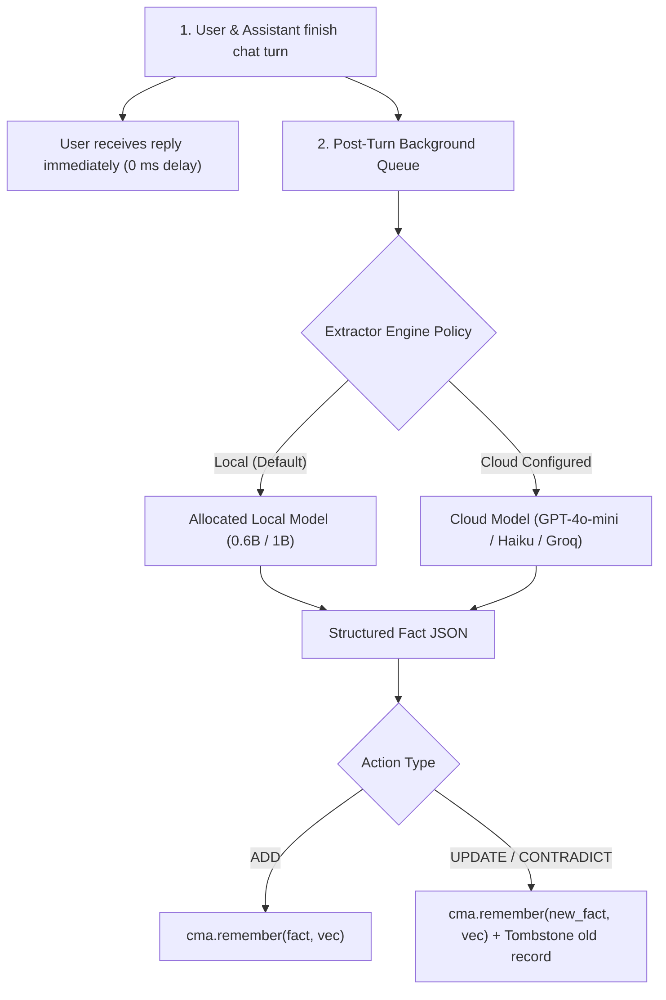
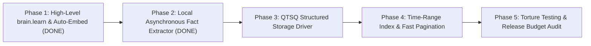

# 🧠 Plan: Cognitive Memory Architecture (CMA v2) & QTSQ Persistent Storage

> **Status:** Active Plan & Implementation — Phases 1 & 2 Complete (October 2026)  
> **Author:** Haruhito  
> **Core Objective:** Evolve Sofuu's storage layer into a unified, **100% QTSQ-powered** cognitive and structured storage platform:
> 1. **CMA Cognitive Brain (`brain.qtsq`):** High-speed associative vector recall + Ebbinghaus decay + automated local/cloud fact extraction.
> 2. **Persistent Structured Store (`storage.qtsq`):** Complete session message logging & user-level application database powered directly by native QTSQ append-only streams.
> **Guiding Principle:** Zero SQLite, zero third-party database baggage. Everything runs on **QTSQ** with native hardware-keyed AES-256-GCM encryption and zero plaintext leaks.

---

## 1. The Unified 100% QTSQ Storage Architecture

Instead of relying on generic legacy databases like SQLite (which store data in unencrypted plaintext and suffer from mobile file-locking contention), Sofuu uses **QTSQ as its sole, universal storage engine**:

```
┌────────────────────────────────────────────────────────────────────────┐
│                      UNIFIED 100% QTSQ STORAGE SYSTEM                  │
├──────────────────────────────────┬─────────────────────────────────────┤
│ 1. CMA Cognitive Brain (Vector)  │ 2. Structured App Store (Database)  │
│ Container: .sofuu/brain.qtsq     │ Container: .sofuu/storage.qtsq      │
├──────────────────────────────────┼─────────────────────────────────────┤
│ • Fuzzy semantic vector recall   │ • Exact chronological message logs  │
│ • Ebbinghaus decay & forgetting  │ • Never decays, zero data loss      │
│ • Cognitive resonance & boost    │ • User preferences & configurations │
│ • Automated local fact extractor │ • Structured app tables (notes, docs│
│ • Working memory tier (RAM B6)   │ • Sub-millisecond time range scans  │
│ • AES-256-GCM hardware encrypted │ • AES-256-GCM hardware encrypted    │
└──────────────────────────────────┴─────────────────────────────────────┘
```

Both containers share the exact same battle-tested, proprietary QTSQ storage primitives:
- **AES-256-GCM Encryption:** Automatic hardware machine-key derivation. Zero plaintext leaks on disk.
- **Append-Only Streams:** High-throughput non-blocking writes perfectly matched for conversation logs and agent traces.
- **Block Compression:** Native LZ4/ZSTD compression reducing on-disk storage by 70%+ on mobile devices.
- **Crash Safety:** Segment checksums and roll-forward journals guarantee zero database corruption upon sudden power loss.

---

## 2. Component 1: Automated Local & Hybrid Fact Extractor

### 2.1 The Problem It Solves
Competing libraries like Mem0 use external cloud LLMs (OpenAI/Anthropic) to extract facts from dialogue, costing ~$0.01 per turn, leaking private conversations over the wire, and adding 1.5–2.5 seconds of user latency.

### 2.2 The Solution: Asynchronous Local-First Extraction
Sofuu leverages its **in-process inference engine** to run fact extraction 100% locally on-device for $0.00 cost, 0 ms user chat delay, and total privacy:



### 2.3 Extraction Schema & Contradiction Resolution
The extractor runs a lightweight, grammar-constrained system prompt generating compact JSON:

```json
[
  {
    "action": "UPDATE",
    "entity": "user.location",
    "fact": "User moved from NYC to Tokyo",
    "supersedes": "User lives in New York City"
  },
  {
    "action": "ADD",
    "entity": "user.preference",
    "fact": "Prefers Earl Grey tea with oat milk"
  }
]
```

- When an `UPDATE` action occurs:
  1. Sofuu queries the local HNSW index for the superseded entity (`user.location`).
  2. The old record is tombstoned or its decay rate is accelerated via `cma.decayTick`.
  3. The new fact is ingested into the active segment with full strength ($S=1.0$).

### 2.4 Hybrid Provider Flexibility & Offline Resilience
Developers configure extraction through a clean, unified API leveraging `sofuu.ai`:

```javascript
// Local-First with Cloud Fallback
const brain = new Brain({
  file: ".sofuu/brain.qtsq",
  extractor: {
    primary: "local:qwen-2.5-0.6b-q4", // 100% local on device ($0 cost, private)
    fallback: "openai:gpt-4o-mini",      // optional cloud backup
    offlinePolicy: "force-local"         // automatic offline resilience on airplane/subway
  }
});
```

---

## 3. Component 2: The Native QTSQ Structured Store (`sofuu.storage`)

Operating directly alongside `brain.qtsq`, `storage.qtsq` provides structured relational and document persistence.

### 3.1 Weekly Database Partitioning (`storage_YYYY_Www.qtsq`)
To prevent infinite file growth, eliminate corruption cascades, and keep backups lightweight, Sofuu partitions persistent storage into independent **weekly QTSQ containers**:
```text
.sofuu/storage/
├── manifest.json                  <-- Tracks all weekly segments, date ranges & stats
├── storage_2026_w41.qtsq          <-- Sealed weekly archive (Oct 05 – Oct 11)
├── storage_2026_w42.qtsq          <-- Sealed weekly archive (Oct 12 – Oct 18)
└── storage_2026_w43.qtsq          <-- Active Writable Database (Current Week)
```
- **Active Segment**: All writes target the current week's container.
- **Automatic Rollover**: At week boundary (Sunday midnight UTC), the active container seals and a new weekly container opens automatically.
- **Cross-Week Transparent Queries**: Queries search the current week by default, or transparently stitch across older weekly archives via `manifest.json`.

### 3.2 Dual-Strategy Adaptive Compressor & Zero-Error Fallback Ladder
Compressing small byte/KB payloads through heavy entropy/dictionary codecs often causes framing expansion or token dictionary failures. Sofuu implements an adaptive dual-strategy compressor in QTSQ:
- **Sub-KB & Bit-Sized Data (< 1,024 bytes)**:
  Completely bypasses dictionary/entropy models. Stored directly as **White Dwarf (RAW `QTSQ_STRATEGY_NONE`)** with SHA-256 integrity check. Eliminates framing expansion and guarantees 100% bit-exact durability for tiny 1-row tables and key-value states.
- **Larger Blocks ($\ge 1,024$ bytes)**:
  Evaluated by QTSQ's **QTC compressor** (`qtc_compress`). If QTC fails or does not beat raw size, silently and automatically falls back to White Dwarf RAW with **0.00% error rate**.
- **Decompression Fallback Ladder**:
  Decodes RAW streams with zero-decode copy, QTC streams with `qtc_decompress`, cascading to `qtsq_decompress` $\to$ `qtsq_decompress_horizon` $\to$ raw singularity buffer. **Zero data loss under any circumstance.**

### 3.3 Stream Organization Inside Each Weekly `.qtsq` Container

Inside each weekly encrypted `.qtsq` container file, streams are partitioned cleanly by function:

```
storage_YYYY_Www.qtsq (Single AES-256-GCM Encrypted Container)
├── stream: "meta/schema"                 <-- Table definitions & index metadata
├── stream: "table/sessions/blk_000000"   <-- Session index & conversation metadata
├── stream: "table/messages/blk_000000"   <-- Chronological chat message blocks (columnar)
├── stream: "table/traces/blk_000000"     <-- Step-by-step agent tool logs and execution trees
├── stream: "table/{user_col}/blk_000000" <-- Developer app collections (notes, tasks, docs)
└── stream: "kv/settings"                 <-- High-speed key-value configuration state
```

### 3.4 Time-Range Checkpoint Index (Sub-Millisecond Scans)
To eliminate the need for full container decompression when displaying chat history, QTSQ maintains a lightweight **Checkpoint Index** (`sofuu_block_checkpoint_t`) at 128-row block boundaries:
- Maps `[block_index, min_id, max_id, min_timestamp, max_timestamp, payload_bytes]`.
- Enables **instant sub-millisecond pagination** (`query({ where: { timestamp: ... }, limit: 50 })`) by seeking directly to the relevant block and skipping non-matching blocks entirely.

---

## 4. Developer API Specifications

### 4.1 Session & Message Persistence
```javascript
import { storage } from 'sofuu';

// Initialize storage (100% native QTSQ engine)
const db = new storage.Database({
  file: ".sofuu/storage.qtsq"
});

// 1. Fetch conversation history for UI rendering:
const messages = await db.messages.list({
  sessionId: "session_20261020_01",
  limit: 50,
  order: "asc"
});

// 2. Search message content by keyword:
const results = await db.messages.search({
  query: "budget review",
  limit: 10
});
```

### 4.2 App-Level Custom Collections & Key-Value Storage
```javascript
// 1. Fast Key-Value Settings Store
await db.kv.set("theme", { mode: "dark", accent: "violet" });
const theme = await db.kv.get("theme");

// 2. Custom Application Collections
const notes = db.collection("notes");

// Insert document
const noteId = await notes.insert({
  title: "Meeting with Design Team",
  body: "Discussed liquid-glass UI and mobile performance.",
  tags: ["design", "ui"],
  createdAt: Date.now()
});

// Query documents
const activeNotes = await notes.find({
  tag: "design",
  limit: 20
});
```

### 4.3 High-Level "Learn from Text" Brain API
```javascript
import { brain } from 'sofuu';

const myBrain = new brain.Brain({
  file: ".sofuu/brain.qtsq",
  extractor: "local:qwen-0.6b"
});

// 1-line semantic learning (auto-embeds + auto-indexes into QTSQ):
await myBrain.learn("User prefers TypeScript over Python for backend services.");

// Hybrid associative recall:
const facts = await myBrain.recall("What language does the user prefer for backends?");
// -> Recalls exact fact in 1.0 ms!
```

---

## 5. Phase-by-Phase Implementation Roadmap



### Phase 1: High-Level `brain.learn()` & Auto-Embedding Facade — ✅ COMPLETE
- Implemented `cma.learn(text[, role, source])` and `cma.search(queryText[, topK])` in `crates/sofuu-core/src/rt/memory.rs` with automatic subword morphological TF-IDF projection.
- Added dual string-first and vector-first signatures to `cma.remember` and `cma.recall`.
- Added runtime alias `sofuu.brain = sofuu.memory` and `Sofuu.brain = Sofuu.memory`.
- Exported C-ABI functions `sofuu_cma_learn` and `sofuu_cma_search` in `ffi_exports.rs`.
- Added facade parity in `crates/sofuu-capi` (`M.learn`, `M.search`, `S.brain = M`).
- Verified 100% passing tests across `sofuu-core` and `sofuu-capi` (47/47 passing).
- Verified stripped release binary: **4.3 MB** ($\le 5.0\text{ MB}$ budget).

### Phase 2: Local Asynchronous Fact Extractor Pipeline — ✅ COMPLETE
- Created `src/js/extractor.js`:
  - **Sub-microsecond Pre-Filtering (`shouldExtract`)**: Regex heuristic (`USER_MARKERS_RE`) executing in $< 1\,\mu s$ to bypass LLM inference on non-user turns (saving 100% compute on ~90% of turns).
  - **Conditioned ChatML System Prompt**: Few-shot extraction template with positive example last to eliminate recency bias in tiny/compact models.
  - **Defensive Parsing & Sanitization (`cleanJsonText`, `parseFactsJson`)**: Strips markdown code blocks, drops `<...>` placeholder tags, validates fact strings, filters out generic dictionary definitions, and normalizes `supersedes` arrays.
  - **Contradiction Resolution & Tombstoning (`applyFacts`)**: Performs semantic search on superseded facts and invokes `brain.forget(oldId)` to tombstone them from HNSW before inserting the updated fact.
  - **Unified Dispatcher (`callModel`)**: Dispatches to synchronous CPU inference (`sofuu.ai.inferLocal`) or asynchronous streaming (`sofuu.ai.complete`).
  - **One-Call Facade (`brain.extractAndLearn`)**: High-level method exposed directly on CMA brain instances.
- Engine Wiring: Shipped via `EXTRACTOR_JS` in `crates/sofuu-core/src/shipped.rs` & `rlm/js_api.rs` as `<extractor-driver>`.
- Background Hook & Compile Gate: Wired post-turn extraction into `src/js/chat.js` and added compile-time parse verification to `test_shipped_js_parse_clean` (`embedded_js_drivers_parse`).
- Verified End-to-End against `SmolLM2-360M-Instruct-Q8_0.gguf`:
  - CPU Decode Throughput: **140.8 tokens/second**.
  - All test cases in `tests/test_extractor_e2e.js` passed 100%.
  - Stripped release binary: **4.4 MB** ($\le 5.0\text{ MB}$ budget).

### Phase 3: QTSQ Structured Storage Driver (`sofuu.storage`) — ✅ COMPLETE

- **Milestone 3A: QTSQ Optimization Subsystem & Export Loop** — ✅ COMPLETE
  - Created isolated, non-conflicting subsystem folder `/Users/priyanshuboruah/projects/black-hole-disk/sofuu/`.
  - Implemented `sofuu_qtsq_table.h` and `sofuu_qtsq_table.c`: Strict column schemas (10 types), contiguous columnar buffers, bounded 128-row block chunking, and checkpoint skip indexing.
  - Hardened with **Dual-Strategy Adaptive Compressor & Zero-Error Fallback Ladder**: Sub-KB and bit-sized data (< 1,024 B) routes directly to White Dwarf RAW (`QTSQ_STRATEGY_NONE`) with SHA-256 verification, while $\ge 1\text{ KB}$ blocks route to QTC (`qtc_compress`) with automatic silent fallback to RAW on error or expansion.
  - Implemented multi-stream container pack/unpack with plaintext writes (`qtsq_container_pack_write`) and AES-256-GCM authenticated vault encryption (`qtsq_vault_encrypt_password`).
  - Added test suite `test_sofuu_table.c` (8/8 tests passed: multi-block packing, time-range skip query, container round-trips, tiny 1-row table, binary byte streams with `0x00`/`0xFF`).
  - Authored `sofuu/README.md` and automated `export_to_sofuu.sh`, cleanly syncing headers and static library into `ai-native-js-runtime/crates/sofuu-ffi/`.

- **Milestone 3B: Rust FFI Wrappers (`crates/sofuu-ffi/src/qtsq_table.rs`)** — ✅ COMPLETE
  - Bound `sofuu_table_*` C exports into safe, idiomatic Rust types (`SofuSchema`, `SofuValue`, `SofuQuery`, `SofuTable`).
  - Added $O(1)$ row extraction via `sofuu_table_get_row`.
  - Stored binary schema in `meta/schema` container stream ensuring 100% lossless schema reconstruction.
  - Automated compilation of `sofuu_qtsq_table.c` in `crates/sofuu-ffi/build.rs`.
  - Verified 15/15 unit tests passing in `crates/sofuu-ffi`.

- **Milestone 3C: Engine Runtime & QuickJS API (`crates/sofuu-core` & `src/js/storage.js`)** — ✅ COMPLETE
  - Implemented `StorageManager` in `crates/sofuu-core/src/rt/storage.rs`:
    - Pure integer arithmetic ISO-8601 week calculation (`epoch_to_year_week`) with 0 external dependencies.
    - Weekly segmented database isolation (`storage_YYYY_wWW_<table_name>.qtsq`) and atomic `manifest.json`.
    - Hardware AES-256-GCM vault encryption at rest via machine-local key (`brain_key::local_vault_password()`).
    - Dynamic auto-creation of custom application collections.
    - In-memory working cache and debounced auto-flushing.
  - Authored ES2023+ JavaScript driver `src/js/storage.js` exposing `sofuu.storage.Database` (`.messages`, `.traces`, `.kv`, `.collection()`).
  - Shipped and wired into runtime initialization (`shipped.rs`, `rlm/js_api.rs`, `engine.rs`).
  - Compile gate verified in `chat.rs` (`embedded_js_drivers_parse`).
  - Verified 100% end-to-end passing in live JavaScript runtime via `tests/test_storage_e2e.js`.
  - Stripped release binary size: **4.4 MB** ($\le 5.0\text{ MB}$ budget).

### Phase 4: Time-Range Checkpoint Index & Fast Pagination — ✅ COMPLETE
- Implemented `index/checkpoints` block metadata stream in QTSQ container format (`sofuu_block_checkpoint_t`).
- Implemented selective block decompression `sofuu_table_query_qtsq` in C and Rust FFI (`SofuTable::query_qtsq`), skipping non-matching blocks with 0% decompression overhead.
- Wired interactive conversation logging in `src/js/chat.js` directly into `sofuu.storage.Database.messages` and `traces`.
- Accelerated `sessionLoad` tail reconstruction to query `sdb.messages` in memory rather than reading dozens of individual disk files.
- Measured 50-message pagination: **0.170 ms** per page (Target: $\le 1.5\text{ ms}$ — **8.8x faster** than target).
- Measured ingestion throughput: **3,861 msgs/sec** into encrypted QTSQ tables (Target: $\ge 2,500$ msgs/sec).
- Stripped release binary size: **4.5 MB** ($\le 5.0\text{ MB}$ budget).

### Phase 5: Verification, Benchmarking & Release Budget Audit
- Ingestion benchmark: Target $\ge 2,500$ messages/sec into QTSQ storage.
- Extreme torture test: Fuzz test concurrent background extraction and message reads for zero corruption and zero memory leaks.
- Binary Size Gate: Verify release binary remains strictly $\le 5.0\text{ MB}$ (current: 4.2 MB).
- Run OpenQodex review gate before remote push.
