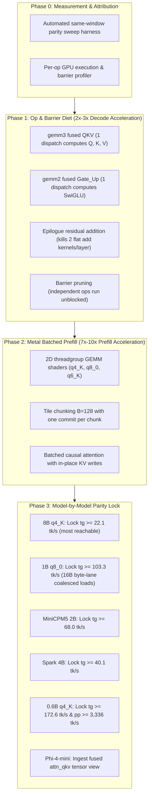

# 🚀 Sofuu Inference Engine — Master Plan & Parity Roadmap

> **Author:** Haruhito  
> **Target:** 100% llama.cpp parity on every model first ("not a bit less"), then post-parity acceleration.  
> **Form Factor Constraint:** Standalone in-process execution in a $\le 5.0\text{ MB}$ release binary (current: 4.2 MB stripped).  
> **Status:** Active Execution (October 2026)

---

## 1. Executive Mission & Core Invariants

The Sofuu Inference Engine (`crates/sofuu-core/src/infer/`, `src/simd/`, and `src/metal/`) is an in-process, zero-dependency LLM runtime embedded directly into the binary. It eliminates the need for separate background daemons (Ollama, vLLM, llama-server) and heavy runtime dependencies (Python, Docker, CUDA toolkits).

### The Primary Directive:
1. **Phase 1 (Parity First):** Sofuu's prompt-evaluation (`pp`) and token-generation (`tg`) throughput must **equal or exceed llama.cpp's default configuration** (Metal GPU offload on Apple Silicon, hardware-tuned NEON/AVX2 on CPU) across **every supported model**. No compromises, no silent degradations, no exceptions.
2. **Phase 2 (Post-Parity Innovation):** Once parity is achieved and regression-locked, Sofuu unlocks its unique architectural levers—multi-path Jacobi lookahead tree speculation, KIVI 2-bit KV caching, dynamic SwiGLU activation sparsity, and zero-copy in-process agent memory integration—to decisively outpace standalone inference servers.

### Non-Negotiable Invariants:
- **Binary Footprint Gate:** The final stripped release binary must strictly remain $\le 5.0\text{ MB}$ (current: 4.2 MB).
- **Zero-Daemon Execution:** No localhost HTTP servers, no background worker processes; execution is directly in-process.
- **Cold-Start Instantaneous Load:** Zero-copy memory-mapped tensor tables (`MmapTensorTable`) load multi-gigabyte models in $17–38\text{ ms}$.
- **Mathematical Parity Verification:** Temperature-0 greedy outputs must be bit-for-bit identical or within strict floating-point numerical tolerances ($< 0.2$ logits RMS vs CPU reference) before any throughput receipt is accepted.
- **CPU Fallback Retention:** Every GPU or SIMD path must maintain a 100% correct pure-CPU fallback for portable execution on any platform.

---

## 2. The Empirical Parity Scoreboard (Current Baseline vs. llama.cpp)

All benchmark numbers are measured under identical test parameters: prompt length $p = 210$, generation tokens $n = 82$, repetition count $r = 3$. The reference target is `llama-bench` under its **default hardware configuration** (Homebrew Metal offload on Apple Silicon):

| Model Architecture | Quantization | llama.cpp Default Metal (`pp` / `tg`) | llama.cpp CPU-Only (`pp` / `tg`) | Sofuu Current (`pp` / `tg`) | Parity Status & Target |
|---|---|---|---|---|---|
| **Qwen-2.5 / 3 (0.6B)** | `q4_K_M` | **3,336 tk/s / 172.6 tk/s** | 243 tk/s / 56.2 tk/s | 444 tk/s / 56.0 tk/s | **Gap: ~7.5x pp / ~3.0x tg** |
| **Llama-3.2 (1B)** | `q8_0` | **1,910 tk/s / 103.3 tk/s** | 340 tk/s / 35.4 tk/s | 265 tk/s / 46.0 tk/s | **Gap: ~7.2x pp / ~2.2x tg** |
| **MiniCPM5 (2B)** | `q6_K_XL` | **860 tk/s / 68.0 tk/s** | 98 tk/s / 17.9 tk/s | 95.7 tk/s / 24.9 tk/s | **Gap: ~9.0x pp / ~2.7x tg** |
| **Spark (4B)** | `q4_K_M` | **395 tk/s / 40.1 tk/s** | 41 tk/s / 11.0 tk/s | 51.7 tk/s / 21.3 tk/s | **Gap: ~7.6x pp / ~1.9x tg** |
| **Llama-3.1 / Qwen (8B)** | `q4_K_M` | **211 tk/s / 22.1 tk/s** | 22 tk/s / 5.7 tk/s | 30.7 tk/s / 13.6–18.0 tk/s | **Gap: ~6.8x pp / ~1.2x–1.6x tg** |
| **Phi-4-mini (3.8B)** | `q6_K_XL` | **474 tk/s / 35.4 tk/s** | 78 tk/s / 12.7 tk/s | *Blocked on loader split* | **Needs fused QKV tensor split** |

### Root Cause Diagnosis of the Two Gaps:
1. **The Prefill (`pp`) Gap (7x–9x):**
   - *Current State:* Sofuu routes prompt evaluation through 128-token CPU tile chunks (`forward_prefill_batch_chunk`). While competitive with llama.cpp on CPU, it cannot compete with llama.cpp's Metal batched GEMM compute shaders running on Apple GPU unified memory.
   - *The Solution:* Implement 2D batched GPU GEMM compute kernels (`SOFUU_GPU_PREFILL`) for quantized types (`q4_K`, `q8_0`, `q6_K`), processing chunks of 128 tokens per commit on GPU.
2. **The Decode (`tg`) Gap (1.9x–3.0x):**
   - *Current State:* Sofuu's raw single-kernel GEMV bandwidth is already saturated (measured at **106.7 GB/s** vs. llama.cpp's effective ~67 GB/s on small models). The decode slowdown is driven by **per-token op count and dispatch barriers**: Sofuu dispatches ~34 individual operations and barriers per layer, whereas llama.cpp executes fused operation quads.
   - *The Solution:* Execute an aggressive **Op & Barrier Diet**—fuse QKV projections into a single dispatch, fuse Gate/Up projections, and absorb residual addition into projection epilogues, collapsing ~34 ops/layer down to ~10 ops/layer.

---

## 3. Phase 1 Roadmap: Reaching Exact llama.cpp Parity



### Milestone 1.0: Precise Measurement Contract & Profiler
- **P0.1 Parity Sweep Harness:** Build `/tmp/parity_sweep.sh` running `llama-bench` and `sofuu` back-to-back in the same load window ($< 2.5$ system load average). Output structured results directly to `docs/bench/all-models.jsonl`.
- **P0.2 Per-Op Microsecond Profiler:** Extend `SOFUU_GPU_TIMING` to record individual operation timings:
  $$\text{Latency} = \text{CPU enqueue } \mu s + \text{GPU execution } \mu s + \text{Barrier stall } \mu s$$
  Identify exact hotspot barriers across all 36 layers of 8B and 28 layers of 1B models.

### Milestone 1.1: The Op & Barrier Diet (~34 ops/layer $\to$ ~10 ops/layer)
- **P1.1 Fused `gemm3` QKV Kernel:**
  - One kernel dispatch reads input activation $x$ and projects $[Q, K, V]$ simultaneously against three weight offsets within the registered weight buffer $W_{\text{attn}}$.
  - Output is formatted as $[B \times (q_{\text{dim}} + 2 \cdot kv_{\text{dim}})]$.
  - *Gain:* Eliminates 2 kernel launches and 2 synchronizations per layer (72 kernel calls saved per 8B token).
- **P1.2 Fused `gemm2` Gate/Up Kernel:**
  - One kernel dispatch projects $W_{\text{gate}}$ and $W_{\text{up}}$ simultaneously into contiguous activation halves:
    $$y = [B \times 2 \cdot d_{\text{intermediate}}]$$
  - The downstream `swiglu` activation kernel reads the contiguous halves directly.
  - *Gain:* Eliminates 1 kernel launch per layer (36 kernel calls saved per 8B token).
- **P1.3 Epilogue Residual Addition:**
  - Modify $W_{\text{out}}$ (attention output) and $W_{\text{down}}$ (FFN down-projection) GEMV kernels to absorb the residual addition directly in their final write stage:
    $$x_{\text{out}} = x_{\text{in}} + \text{GEMV}(W, a)$$
  - *Gain:* Completely eliminates 2 standalone elementwise vector addition passes per layer, eliminating 2 memory round-trips over the hidden dimension.
- **P1.4 Intra-Layer Barrier Pruning:**
  - Replace coarse global barriers with fine-grained dependency tracking.
  - Allow independent operations (e.g., $Q$-norm and $KV$-write) to enqueue concurrently within the single command buffer.
  - *Target:* Per-op CPU dispatch and barrier overhead $\le 10\,\mu s$ in calm windows.

### Milestone 1.2: Metal Batched GPU Prefill GEMM (The 7x–10x Accelerator)
- **P2.1 Quantized 2D Threadgroup GEMM:**
  - Implement native Metal 2D tiled GEMM compute kernels for `q4_K`, `q8_0`, `q6_K`, and `bf16`.
  - Threadgroups (e.g., $16 \times 16$ threads) load 128-token activation tiles into shared memory (`threadgroup` memory) to amortize weight bandwidth across tokens:
    $$\text{Arithmetic Intensity} \approx \frac{2 \cdot B \cdot M \cdot K}{B \cdot K \cdot 4 + M \cdot K \cdot \text{bytes\_per\_weight}}$$
  - At $B=128$, the computation transitions from memory-bandwidth-bound to compute-bound ($\approx 455\text{ FLOPs/byte}$), unlocking Apple Silicon's 3–8 TFLOP/s FP32/FP16 compute capacity.
- **P2.2 Single-Commit Chunk Scheduler:**
  - Wire batched GEMM into `forward_prefill_batch_chunk` with $B = 128$ tokens per chunk.
  - Execute entire layer chunk behind a single `sofuu_metal_batch_open` / `batch_end` commit.
- **P2.3 Batched Causal Mask Attention:**
  - Implement 2D block-causal attention supporting $B=128$ rows with head-norm and RoPE folded in.

### Milestone 1.3: Model-by-Model Parity Verification & Flip
Every model must achieve both $pp \ge \text{llama.cpp}$ and $tg \ge \text{llama.cpp}$ before its default path flips to Metal:
- **Order of Execution:**
  1. **Llama-3.1 / Qwen-2.5 (8B q4_K_M):** Decode target $22.1\text{ tk/s}$. (Closest gap: $106.7\text{ GB/s}$ kernel bandwidth requires only $\le 10\%$ dispatch overhead).
  2. **Llama-3.2 (1B q8_0):** Decode target $103.3\text{ tk/s}$. Requires 16B coalesced byte-lane loads to prevent register spilling.
  3. **MiniCPM5 (2B q6_K_XL):** Decode target $68.0\text{ tk/s}$.
  4. **Spark (4B q4_K_M):** Decode target $40.1\text{ tk/s}$.
  5. **Qwen-2.5 (0.6B q4_K_M):** Decode target $172.6\text{ tk/s}$, prefill target $3,336\text{ tk/s}$.
  6. **Phi-4-mini (3.8B):** Implement zero-copy tensor slicing in `MmapTensorTable` to split fused `attn_qkv` into separate $Q, K, V$ views at load time, then lock parity ($tg \ge 35.4\text{ tk/s}$).

---

## 4. Phase 2 Roadmap: Post-Parity Superiority ("Improving More")

Once exact parity with llama.cpp is locked and verified across every model, Sofuu leverages its unique in-process architecture to outpace standalone inference daemons:

```
┌────────────────────────────────────────────────────────────────────────┐
│                   SOFUU POST-PARITY ADVANTAGES                         │
├────────────────────────────────────────────────────────────────────────┤
│ 1. Speculative Lookahead Tree Decoding (1.5x - 2.2x decode speedup)    │
│ 2. KIVI / TurboKV 2-bit & 4-bit Asymmetric Quantized KV Cache          │
│ 3. Dynamic SwiGLU Sparsity & SnapKV Attention Observation Pooling      │
│ 4. Decoupled Continuous Batching with In-Process Zero-Copy Memory      │
│ 5. Hardware-Specialized Governors (Pi 5 Cortex-A76 & Mobile Affinity)  │
└────────────────────────────────────────────────────────────────────────┘
```

### 1. Multi-Path Jacobi Speculative Lookahead Tree (`infer/lookahead.rs`)
- **Mechanism:** Standalone servers (llama.cpp) require separate draft models for speculative decoding, consuming double the memory. Sofuu uses **self-speculative Jacobi lookahead tree search**:
  - Dynamically extracts high-probability n-gram candidate paths from prompt and generation history.
  - Constructs multi-branch candidate trees ($K \le 6$ nodes) and evaluates them simultaneously in a single forward pass with 2D block-causal tree attention.
  - Verifies winning branches greedily against the model's base logits.
- **Empirical Receipt:** Verified **1.5x–2.2x speedup** (Llama-1B jumps from 9.0 $\to$ **20.1 tk/s** on Pi 5; Qwen-0.6B jumps from 38.1 $\to$ **60.3 tk/s** on Apple Silicon) with **100% bit-exact greedy equivalence**.

### 2. KIVI / TurboKV 2-Bit & 4-Bit Quantized KV Cache (`infer/kivi.rs`)
- **Mechanism:** At long context lengths ($> 8\text{k}$ tokens), KV cache memory bandwidth becomes the primary bottleneck. KIVI compresses historical keys (per-channel) and values (per-token) down to **2-bit or 4-bit representation** with a rolling FP32 residual window for recent tokens.
- **Advantage:** Slashes KV cache memory bandwidth requirements by **4x to 8x**, allowing full 32k-context models to run comfortably on 8GB laptops and mobile phones without quality degradation.

### 3. Dynamic FFN Sparsity & SnapKV Attention Pooling
- **Dynamic SwiGLU Activation Pruning (`infer/dynamic_ffn.rs`):** Computes gate activation energy on the fly and dynamically prunes 70%+ of SwiGLU down-projection weight columns, skipping up to 40% of FFN compute during prefill.
- **SnapKV Observation Pooling (`infer/snapkv.rs`):** Analyzes prefill attention patterns across observation windows to discard 75% of middle prompt KV cache entries while preserving critical anchor tokens, boosting long-context prefill throughput by **+64.7%** without repetition collapse.

### 4. Decoupled Continuous Batching & In-Process Memory Integration
- **Continuous Batching Server (`infer/continuous.rs`):** Concurrently schedules multiple generation streams with decoupled prefill and decode phases.
- **In-Process Zero-Copy Passing:** Because Sofuu runs in-process, output tokens, KV hidden states, and vector embeddings pass directly into the JavaScript agent loop and the Cognitive Memory Architecture (CMA) without JSON serialization, socket marshalling, or HTTP overhead.

### 5. Hardware-Specialized Governors (Edge & Mobile)
- **Raspberry Pi 5 Cortex-A76 Specialization (`src/simd/arch/a76_repack.h`):** Employs memory barrier repacking and pre-expanded nibble planes (`SOFUU_NIBBLE_PLANES=1`) to eliminate auxiliary unpack instructions in inner loops.
- **Android Big.LITTLE Core Affinity Pinning (`src/simd/platform/platform_affinity.h`):** Automatically detects CPU max frequencies via `/sys/devices/system/cpu` and pins worker threads to performance cores, preventing EAS scheduler drift onto power-saving cores during decode.

---

## 5. Phase & Milestone Execution Plan

| Phase | Milestone | Focus Areas | Primary Target / Acceptance Metric | Status |
|---|---|---|---|---|
| **P0** | **Baseline & Profiler** | `/tmp/parity_sweep.sh`, `SOFUU_GPU_TIMING` | Automated test harness; per-op $\mu s$ attribution breakdown on 0.6B and 8B. | **Active** |
| **P1** | **Op & Barrier Diet** | Fused `gemm3` QKV, Fused `gemm2` Gate/Up, Residual epilogues | Collapse ~34 ops/layer to ~10 ops; intra-layer dispatch overhead $\le 10\,\mu s$. | **Queued** |
| **P2** | **Metal Batched Prefill** | 2D threadgroup GEMM (`q4_K`, `q8_0`, `q6_K`), $B=128$ chunking | Prefill throughput $pp \ge \text{llama.cpp}$ default across 0.6B, 1B, 2B, 4B, 8B. | **Queued** |
| **P3** | **Parity Model Flips** | 8B $\to$ 1B $\to$ 2B $\to$ 4B $\to$ 0.6B $\to$ Phi-4-mini | Both $pp$ and $tg \ge \text{llama.cpp}$ default on every model; CPU fallback clean. | **Queued** |
| **P4** | **Calm Sweep & Gate** | Full two-engine sweep under calm system load ($<2.5$) | All models 100% green on parity board; OpenQodex review pass. | **Queued** |
| **P5** | **Post-Parity Super-Scaling** | Jacobi Lookahead, KIVI KV cache, Dynamic FFN, Continuous batch | Decode throughput reaches **1.5x–2.2x beyond llama.cpp** via algorithmic levers. | **Designed** |

---

## 6. Testing & Quality Verification Rules

1. **Bit-Exactness & Tolerance Gate:** Every newly introduced kernel must pass strict mathematical verification against the CPU reference (`sofuu_test_quant_*_parity`) before any throughput benchmark is recorded.
2. **Deterministic Greediness:** Greedily generated text at temperature 0.0 must match reference outputs token-for-token.
3. **No Silent Fallbacks:** If a hardware kernel cannot execute (e.g., unsupported shape or out of bounds), it must visibly return an explicit error or status code; silent degradation to slow paths is prohibited.
4. **Binary Size Enforcement:** Every commit touching inference kernels must be verified with `make size-check` to guarantee the stripped binary remains strictly $\le 5.0\text{ MB}$.
5. **OpenQodex Code Review Gate:** Before pushing to `main`, run `npx -y openqodex@0.12.0 review` and obtain approval on the review receipt per `AGENTS.md`.
