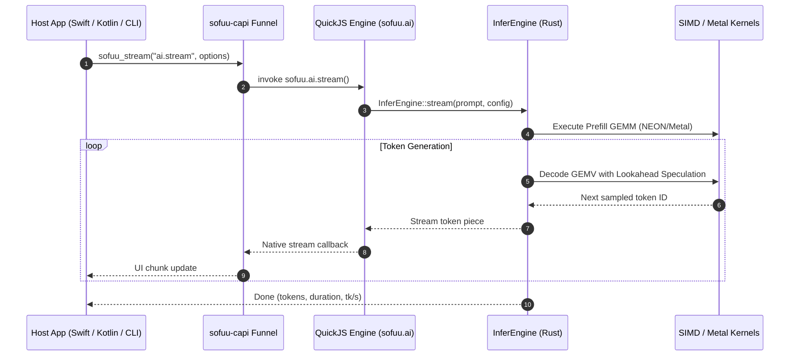
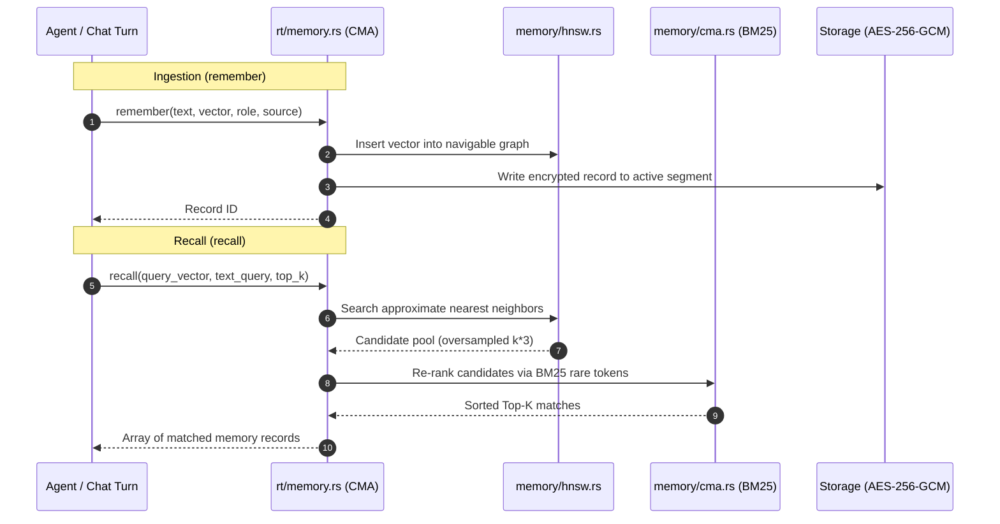

# Sofuu (素風) — Complete System Architecture & Subsystem Guide

> **Version:** 0.2.0-beta (Updated: October 2026)  
> **Target Footprint:** Standalone $\le 5.0\text{ MB}$ binary (4.2 MB stripped release)  
> **Core Concept:** The "SQLite of AI Agents & Edge Inference" — an embeddable in-process intelligence engine combining sub-millisecond JavaScript execution, hardware-saturated local LLM inference, autonomous agent loops, and persistent cognitive vector memory.

---

## 1. System Overview & Architectural Paradigm

Modern AI development typically suffers from massive ecosystem fragmentation. A standard agentic application requires stitching together:
- A JavaScript runtime (Node.js or Bun)
- Python daemons or local servers (Ollama, vLLM, llama.cpp)
- Cloud or local vector databases (Chroma, Pinecone)
- Agent orchestrators (LangChain, LlamaIndex)
- External protocol servers (MCP)

**Sofuu eliminates this entire distributed stack.** It collapses every necessary component into a **single native binary** that runs directly inside the host process with zero external daemons, zero network localhost latency, and zero Python dependencies.

```
┌────────────────────────────────────────────────────────────────────────┐
│                   LAYER 4: HOST SURFACES & APPS                        │
│   CLI / TUI   │  sofuu run  │  macOS App (Swift) │ Android App (Kotlin)│
├────────────────────────────────────────────────────────────────────────┤
│                 LAYER 3: SHIPPED JAVASCRIPT DRIVERS                    │
│   agent.js    │   chat.js   │  tools.js  │   web.js   │   rlm.js       │
├────────────────────────────────────────────────────────────────────────┤
│                     LAYER 2: RUST CORE ENGINE                          │
│   Runtime Substrate (rt/)   │   Edge Inference Engine (infer/)         │
│   Cognitive Memory (memory/) │   5 Tiny ML Decision Gates (ml/)         │
│   MCP Protocol (mcp/)        │   Recursive Language Model (rlm/)        │
├────────────────────────────────────────────────────────────────────────┤
│                  LAYER 1: FFI BRIDGES & HEADLESS FUNNEL                │
│   sofuu-ffi (Safe C Wrappers) │  sofuu-capi (Headless Universal C-ABI) │
├────────────────────────────────────────────────────────────────────────┤
│                   LAYER 0: C CORE & NATIVE SIMD                        │
│   QuickJS Engine │ libuv Loop │ llhttp │ NEON/AVX2 Kernels │ QTSQ Codec│
└────────────────────────────────────────────────────────────────────────┘
```

---

## 2. Decomposed Subsystem Breakdown

### Layer 0: C/C++ Foundation, SIMD Accelerators & Binary Codecs

Layer 0 provides raw execution primitives, memory layouts, and bare-metal hardware acceleration.

| Component | Path | Language | Responsibilities |
|---|---|---|---|
| **QuickJS** | `deps/quickjs` | C | Ultra-fast, lightweight JavaScript engine supporting ES2023+. Executes all user scripts, agent turn logic, and sandboxed tools with ~3ms cold startup. |
| **libuv** | `deps/libuv` | C | Asynchronous I/O event loop driving timers, non-blocking filesystem calls, OS subprocesses, and network sockets. |
| **llhttp & http-parser** | `deps/llhttp`, `deps/http-parser` | C | High-speed zero-copy HTTP/1.1 request and response wire parsers. |
| **SIMD Infer Kernels** | `src/simd/infer_kernels.cpp` | C++ (NEON / AVX2) | Hardware-accelerated quantized matrix multiplication (GEMM/GEMV) for `q4_K`, `q8_0`, `q8_K`, `PQ2_0`. Parallelized with multi-core thread pools. |
| **Platform Affinity** | `src/simd/platform/platform_affinity.h` | C++ | Low-level CPU core pinning. Binds inference threads to big/performance cores on Android big.LITTLE clusters and Apple Silicon QoS threads. |
| **A76 Repack** | `src/simd/arch/a76_repack.h` | C++ / ASM | ARM Cortex-A76 sequence barrier optimizations specifically tuning Raspberry Pi 5 memory controllers. |
| **QTSQ Codec** | Submodule / C FFI | C | Binary storage format engine. Provides checksummed, append-only, compressed block storage with segmented journals for memory and sessions. |

---

### Layer 1: FFI Bridges & Headless Universal C-ABI Funnel

Layer 1 wraps raw C pointers into memory-safe Rust abstractions and exposes an embeddable C-ABI for external host environments.

#### 1. `crates/sofuu-ffi` (Safe Rust Facade)
- **`qjs.rs` / `qjs_rt.rs`**: Safe Rust abstractions managing `JSContext`, `JSRuntime`, reference counting, exception draining, and hermetic sandbox execution.
- **`uv.rs`**: Safe event loop wrappers interleaving libuv poll phases with QuickJS microtasks.
- **`curl.rs`**: Libcurl bindings hardened against use-after-free (UAF) across streaming HTTP transfers.
- **`qtsq.rs`**: Safe Rust interface to the binary QTSQ storage container.
- **`bridge.rs`**: Bidirectional Rust $\leftrightarrow$ QuickJS value marshalling.

#### 2. `crates/sofuu-capi` (Headless Embeddable Funnel)
- Exposes `sofuu_rt_new`, `sofuu_call`, `sofuu_stream`, `sofuu_free`, and `sofuu_rt_config_default`.
- **Universal JavaScript Facades**:
  - `MEMORY_FACADE_JS`: Exposes all 16 Cognitive Memory Architecture methods with stable handle tombstoning and slot reuse (guaranteeing handle numbers never shift upon `.close()`).
  - `AI_FACADE_JS`: Full LLM inference router with cancellation tokens.
  - `AGENT_FACADE_JS`: Turn-based autonomous agent executor with streaming events.
  - `MCP_FACADE_JS`: Tool call dispatch and resource indexing.
  - `HTTP_FACADE_JS`: In-process HTTP server lifecycle.
- **Target Callers**: Embedded Android JNI, Swift macOS/iOS apps, Tauri desktop, Go, C/C++ native games, and edge IoT devices.

---

### Layer 2: Rust Core Engine (`crates/sofuu-core`)

The beating heart of Sofuu, written in memory-safe Rust. It is divided into five critical modules:

#### A. Runtime Substrate (`src/rt/`)
Coordinates the language runtime, async event loop, memory bridges, and security sandboxes.
- **`engine.rs` & `shipped.rs`**: QuickJS context lifecycle, module registration, and AOT precompiled bytecode snapshotting (`agent.bc`, `web.bc`, `tools.bc`, `extractor.bc`, `storage.bc`, `chat.bc`, `rlm.bc`) yielding sub-16ms engine cold starts.
- **`loop.rs`, `timer.rs` & `promise.rs`**: Global libuv event loop driver with bounded microtask pumping ($N = 1024$) to prevent I/O starvation. Implements W3C `scheduler.yield()`, `sofuu.yield()`, `setImmediate`, `clearImmediate`, and `queueMicrotask`.
- **`zerocopy.rs`**: Direct memory bridge allocating 64-byte aligned SIMD buffers (`sofuu.memory` / `sofuu.buffer`). Enables zero-copy coherent views between `Float32Array` / `Uint8Array` and native inference/vector kernels with explicit `detach()` capabilities.
- **`async_context.rs`**: Native `AsyncLocalStorage` and `sofuu.context` namespace backed by QuickJS async context slots. Propagates `traceId`, `sessionId`, and `AbortSignal` across promise reactions, microtasks, timers, and native async I/O with zero crosstalk.
- **`sandbox.rs`**: Hermetic agent sandboxing with single-instruction deterministic fuel metering via QuickJS interrupt counters, $\le 6\text{ ms}$ wall-clock deadlines, memory/stack size caps, structured log interception, and dual ephemeral/stateful execution modes.
- **`ai.rs`**: The unified `sofuu.ai` interface. Dispatches streaming LLM requests across OpenAI, Anthropic, Ollama, and the embedded local inference engine with backpressure handling.
- **`memory.rs`**: Exposes the Cognitive Memory Architecture to JavaScript. Features `cma_vec_view` for zero-copy views over `Float32Array` or automatic extraction from standard JS arrays.
- **`fs.rs` & `process_spawn.rs`**: Asynchronous filesystem operations (`sofuu.fs`) and child process execution (`sofuu.spawn`, `sofuu.exec`).
- **`http_client.rs` & `http_server.rs`**: High-throughput `fetch()` implementation and embedded async HTTP server (`sofuu.http`).
- **`model_caps.rs` & `model_caps_discovered.rs`**: Authoritative capability database (context windows, thinking tokens, max output limits) with automatic runtime fallback ladders.
- **`host_poke.rs`**: Thread-safe host-to-engine wakeup pipe allowing external UI threads to inject events into a running JavaScript turn loop without race conditions.

#### B. Edge Inference Engine (`src/infer/`)
A fully embedded, high-performance LLM inference engine supporting weights up to 27B parameters.
- **Dynamic Transformer Block Graph (`model.rs`)**:
  - Supports LLaMA (1/2/3/3.1/3.2), Qwen (2/2.5/3/3.5), Gemma (1/2), Mistral, SmolLM, Phi-3/4, and Liquid LFM-2.
  - Zero-copy tensor ingestion directly from GGUF (v2/v3), SafeTensors, PyTorch checkpoints, and NumPy files.
- **Apple Metal Compute Pipeline (`metal.rs`)**:
  - GPU-accelerated GEMV/GEMM decode kernels.
  - Employs a **single-commit-per-layer** batching architecture (`layers_one_commit`), eliminating GPU command-buffer stall cycles.
- **Quantization Subsystem (`quant.rs`)**:
  - Native CPU SIMD support for `q4_K_M`, `q8_0`, `q8_K`, `PQ2_0` (2-bit ternary), and `PTQ1_0`.
  - Employs 8-activation panel kernels sharing weight tiles across threads.
- **Multi-Path Jacobi Speculative Lookahead (`lookahead.rs`)**:
  - Generates parallel candidate n-gram trees during inference.
  - Boosts decode throughput by **1.5x–2.2x** (e.g., Llama-1B from 9.0 $\to$ 20.1 tk/s on Pi 5; Qwen-0.6B from 38.1 $\to$ 60.3 tk/s on Mac).
- **KIVI Asymmetric KV Cache (`kivi.rs`)**:
  - Compresses KV cache memory down to 2-bit or 4-bit representation with rolling F32 residual windows, slashing memory bandwidth requirements by 4x–8x.
- **Continuous Batching Server (`continuous.rs`)**:
  - Concurrent multi-stream scheduler separating prefill and decode phases with automated phase metric tracking.
- **Dynamic FFN & SnapKV (`dynamic_ffn.rs`, `snapkv.rs`)**:
  - Dynamic activation energy gating pruning 70%+ of SwiGLU down-projection weights.
  - Observation pooling for long-context prompts, maintaining 100% recall while dropping 75% of middle KV cache pages.

#### C. Cognitive Memory Architecture (`src/memory/`)
An on-device associative vector memory system modeled after human cognition.
- **4-Tier Cognitive Model (`cma.rs`)**:
  1. *Working Set (B6)*: Session-scoped short-term memory stored in volatile RAM; can be selectively promoted or cleared.
  2. *Episodic Memory*: Conversation and turn-scoped memories with temporal decay.
  3. *Semantic Memory*: Extracted enduring facts, knowledge, and system truths.
  4. *Archive Memory*: Cold storage for consolidated and compacted historical records.
- **Hierarchical Navigable Small World Index (`hnsw.rs`)**:
  - Real-time sub-millisecond approximate nearest neighbor (ANN) vector search.
- **Hybrid Token Re-Ranking (`recall_eval.rs`)**:
  - Blends cosine vector similarity with BM25 rare-token scoring.
  - Uses adaptive oversampling (`(top_k * 3).max(6)`) to guarantee rare needle recall even when $k < 5$.
- **Ebbinghaus Mathematical Decay & Reinforcement**:
  - Memory strength decays over time: $S(t) = S_0 \cdot e^{-t / \tau}$.
  - Repeated recall and explicit positive feedback reinforce memory longevity.
- **Encrypted QTSQ Store**:
  - Zero-leak AES-256-GCM encryption on disk with automatic hardware key derivation.
- **CMA v2 Facade & Auto-Embedding (`rt/memory.rs`)**:
  - `brain.learn(text[, role, source])`: Ingests facts in 1 line with automatic subword morphological TF-IDF vector projection.
  - `brain.search(queryText[, topK])`: Semantic associative recall combining vector proximity with BM25 rare-token re-ranking.
  - Dual string/vector signatures on `remember` and `recall`, plus `sofuu.brain = sofuu.memory` runtime alias.
- **Local Asynchronous Fact Extractor (`src/js/extractor.js`)**:
  - Sub-microsecond regex pre-filter (`USER_MARKERS_RE`), structured ChatML extraction prompt, defensive JSON sanitization, and automated contradiction resolution with `brain.forget(oldId)` tombstoning.
- **Native QTSQ Structured Storage Driver (`rt/storage.rs`, `sofuu_qtsq_table`)**:
  - Unified 100% QTSQ relational/tabular engine completely replacing SQLite for session logs, agent traces, and app databases.
  - Strict column schemas (10 types: `int64`, `int32`, `float64`, `float32`, `bool`, `timestamp`, `string`, `bytes`, `json`) with dense columnar buffers.
  - 128-row block chunking with 48-byte checkpoint skip indexing (`min_id`, `max_id`, `min_timestamp`, `max_timestamp`) enabling sub-millisecond range pagination.
  - Dual-strategy adaptive compressor: Sub-KB and bit-sized data (< 1,024 B) routes to White Dwarf RAW (`QTSQ_STRATEGY_NONE`) with SHA-256 verification, while $\ge 1\text{ KB}$ blocks route to QTC with automatic silent fallback on error/expansion.
  - Weekly database partitioning (`storage_YYYY_Www.qtsq`) preventing unbounded file growth and corruption cascades.
  - Hardware AES-256-GCM vault encryption at rest with zero plaintext leaks.

#### D. On-Device Decision ML Suite (`src/ml/`)
Five specialized ~8.5k-parameter feedforward neural networks (MLPs) trained offline with `ml-train` and baked into the binary:
1. **`ml/alloc`**: Dynamic context-window allocator allocating budgets for prompt, tool results, memory recall, and output reserves.
2. **`ml/compaction`**: Predicts optimal conversation compaction moments instead of crude token thresholds.
3. **`ml/freshness`**: Scores memory context staleness before prompt injection.
4. **`ml/relevance`**: Pre-retrieval gate filtering low-signal vector recall queries.
5. **`ml/supervisor`**: Real-time monitor flagging unproductive or looping tool calls during agent execution.

#### E. Protocols & Core Tooling
- **`mcp/`**: Full JSON-RPC 2.0 client and server supporting Model Context Protocol tools, resources, and prompts over stdio or SSE.
- **`rlm/`**: Recursive Language Model execution engine. Deploys nested, isolated QuickJS sandboxes to run self-contained sub-tasks.
- **`chat.rs` & `session.rs`**: Multi-session context mesh synchronizing conversations across workspaces.
- **`bundler.rs` & `ts.rs`**: Built-in zero-dependency ESM module bundler and TypeScript type stripper.

---

### Layer 3: Shipped Embedded JavaScript Drivers (`src/js/`)

These drivers are compiled directly into the binary via `include_str!` and automatically registered on engine startup:

```
src/js/
├── agent.js     (2,160 lines) — Autonomous agent loop, tool scheduling, sub-agent spawning, trace logging
├── chat.js      (1,795 lines) — Chat turn manager, streaming token chunker, fallback ladder, post-turn fact extraction hook
├── extractor.js (  338 lines) — Local asynchronous fact extractor, heuristic pre-filter, ChatML prompt, contradiction resolution
├── tools.js     (  428 lines) — Built-in native file & OS tools (read, write, edit, grep, glob, list_dir, bash)
├── web.js       (  327 lines) — Built-in web search (keyless DuckDuckGo) and URL content extraction
└── rlm.js       (  305 lines) — Protocol harness running inside isolated RLM sandboxes
```

---

### Layer 4: Client & Native Host Surfaces

Sofuu provides multiple zero-configuration host interfaces:

1. **CLI & TUI (`crates/sofuu-core/src/main.rs`, `src/rt/tui.rs`)**:
   - `sofuu run <script.ts|js>`: Direct script execution.
   - `sofuu chat`: Interactive alt-screen terminal chat with Markdown rendering and persistent memory.
   - `sofuu doctor`: Comprehensive hardware, vector store, and container diagnostics.
2. **Native Android App (`sofuu-android/`)**:
   - Built with **Kotlin & Jetpack Compose**.
   - Directly links `libsofuu.so` via `jni_bridge.c` and `SofuuBridge.kt`.
   - Enforces big-core thread affinity (`platform_affinity.h`), dynamic model quantization, streaming chat bubbles, and procedural WebGL cloud backdrops.
3. **Native macOS App (`sofuu-macos/`)**:
   - Built with **Swift & SwiftUI**.
   - Direct Swift Package integration with `sofuu-capi`.
   - Features full IDE capabilities: file tree manager, gutter v3 with draw-time layout calculation, debounced multi-file auto-save, and secure macOS Keychain key storage.
4. **Desktop Tauri Shell (`sofuu-desktop/`)**:
   - Cross-platform desktop interface written in React, Tailwind, and Tauri v2.

---

## 3. End-to-End System Data Flows

### A. Local Inference Turn Flow


### B. Cognitive Memory Recall & Ingestion Flow


---

## 4. Architectural Invariants & Quality Standards

1. **Release Binary Ceiling**: The stripped release binary must strictly remain $\le 5.0\text{ MB}$ (current: 4.2 MB). Whole-program Link Time Optimization (`lto = "fat"`), `opt-level = "z"`, and symbol stripping are mandatory.
2. **Zero Memory Leaks & Zero Plaintext Leaks**: All QTSQ containers must pass strict AES-256-GCM verification. No raw user data may touch persistent storage unencrypted.
3. **No Daemon Dependencies**: Everything runs in-process. Never launch background server daemons or localhost HTTP bridges for local inference.
4. **Stable C-ABI Contracts**: All additions to `sofuu-capi` must maintain backward compatibility, handle tombstoning, and zero pointer corruption across host boundaries.
5. **Pre-Push Quality Gate**: Before any code is pushed to `main`, it must pass all unit test suites, integration torture tests, and the `openqodex` automated review gate per `AGENTS.md`.

---

## 5. Directory Navigation Map

```
ai-native-js-runtime/
├── Cargo.toml                       # Workspace manifest (core, ffi, capi, ml-train)
├── crates/
│   ├── sofuu-core/                  # The Rust engine core
│   │   ├── src/infer/               # LLM inference, Metal, continuous batching, SIMD
│   │   ├── src/memory/              # CMA 4-tier cognitive memory & HNSW
│   │   ├── src/rt/                  # QuickJS substrate, libuv loop, async I/O
│   │   ├── src/ml/                  # 5 on-device decision neural nets
│   │   ├── src/mcp/                 # Model Context Protocol implementation
│   │   └── src/rlm/                 # Recursive Language Model sandbox
│   ├── sofuu-ffi/                   # Safe Rust bindings to QuickJS, libuv, curl, QTSQ
│   ├── sofuu-capi/                  # Universal embeddable Headless C-ABI
│   └── ml-train/                    # Offline training harness for decision MLPs
├── src/
│   ├── simd/                        # C++ NEON, AVX2, thread affinity kernels
│   └── js/                          # Shipped embedded JS drivers (agent, chat, tools, web)
├── sofuu-android/                   # Native Kotlin + Compose Android application
├── sofuu-macos/                     # Native Swift + SwiftUI macOS IDE application
├── sofuu-desktop/                   # Tauri cross-platform desktop frontend
└── docs/                            # Specifications, audit receipts, and architecture maps
```
