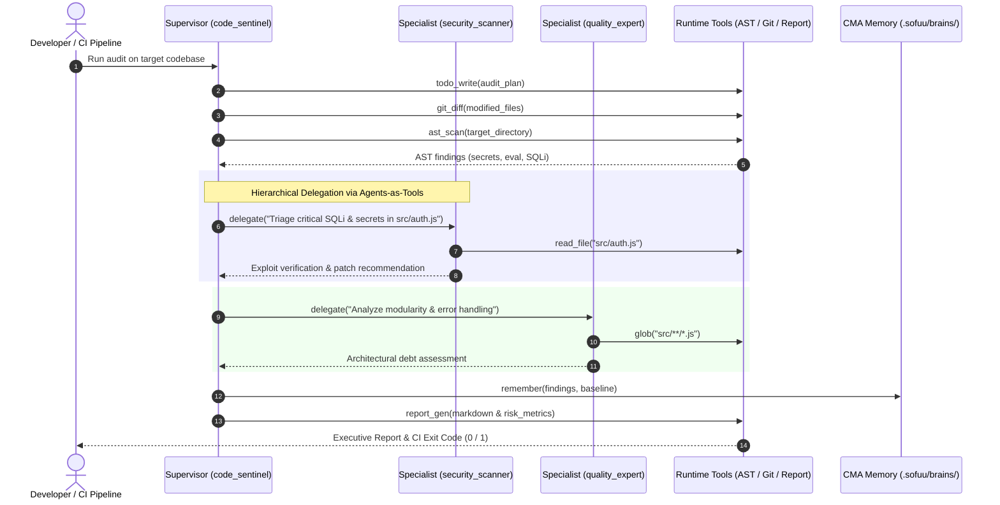

# 🛡️ Code Sentinel — Production AI Agent Example

> **Production-grade, multi-agent code intelligence and security auditing system built natively on Sofuu.**  
> *100% JavaScript (ESM) — Zero auxiliary scripts, zero Node.js runtime baggage, sub-15ms cold start.*

---

## 1. Overview & Architecture

**Code Sentinel** is an autonomous code reviewer and security auditor designed for continuous integration (CI/CD) pipelines and developer workstations. It inspects repositories, scans for vulnerabilities (OWASP Top 10, CWE flaw patterns, secret leaks, code injection), coordinates specialist sub-agents, and produces executive security audit artifacts.

### Multi-Agent Coordination Topology



---

## 2. Key Components

| File | Purpose |
| :--- | :--- |
| [`index.js`](index.js) | Production CLI executable and programmatic SDK entry point |
| [`models.json`](models.json) | Dedicated per-agent providers & models configuration file |
| [`agent.config.json`](agent.config.json) | Agent behavior configuration (budgets, thresholds, memory scope) |
| [`lib/sentinel.js`](lib/sentinel.js) | Supervisor agent definition (`code_sentinel`) and orchestration |
| [`lib/specialists/security.js`](lib/specialists/security.js) | Vulnerability triage sub-agent (`security_scanner`) |
| [`lib/specialists/quality.js`](lib/specialists/quality.js) | Software architecture sub-agent (`quality_expert`) |
| [`lib/tools/ast_scan.js`](lib/tools/ast_scan.js) | Deterministic static analysis tool (secrets, eval, injection, prototype pollution) |
| [`lib/tools/report_gen.js`](lib/tools/report_gen.js) | Formatted Markdown / JSON report synthesizer and risk scoring engine |
| [`lib/tools/git_diff.js`](lib/tools/git_diff.js) | Safe repository status and diff summary inspector |
| [`lib/memory.js`](lib/memory.js) | Continuous memory learning and historical recall via Sofuu CMA/QTSQ |
| [`tests/test_sentinel.js`](tests/test_sentinel.js) | Automated verification battery |

---

## 3. Quickstart: Two Generalized Ways to Configure Models & Providers

Every agent in Sofuu (both JS scripts and compiled binaries) supports **two simple ways** to configure providers and models:

### Way 1: Per-Agent Config File (`models.json`)
Edit [`models.json`](models.json) next to the agent (or `<binary-name>.models.json` next to a compiled binary):
```json
{
  "active": "anthropic",
  "providers": {
    "anthropic": {
      "provider": "anthropic",
      "model": "claude-3-5-sonnet-20241022",
      "api_key": "env:ANTHROPIC_API_KEY"
    },
    "openai": {
      "provider": "openai",
      "model": "gpt-4o",
      "api_key": "env:OPENAI_API_KEY"
    }
  }
}
```
> `"api_key"` supports `"env:VAR_NAME"` or a literal API key string.

### Way 2: Built-In Commands (`--setup-model`, `--edit-model`, `--list-models`)
Works identically on **compiled standalone binaries** (`./code-sentinel`) and **`sofuu run`**:

```bash
# 1. Compile to standalone native binary
./sofuu compile production-agent-example/index.js -o ./code-sentinel

# 2. Add a provider & model interactively
./code-sentinel --setup-model

# 3. Edit, switch active, add, or delete providers/models
./code-sentinel --edit-model

# 4. Inspect configured models for this binary
./code-sentinel --list-models
```
*(When running as a script, use the same flags with `sofuu run production-agent-example/index.js --setup-model` / `--edit-model` / `--list-models`.)*

### Running the Agent
```bash
# Interactive TUI chat
./sofuu run production-agent-example/index.js --interactive
# or with compiled binary:
./code-sentinel -i

# Override profile or model for a single run
./code-sentinel -i --provider openai
./sofuu run production-agent-example/index.js --target ./src --json
```
- **Exit Code 0:** Clean or low-risk audit (Risk Score $\ge 85$).
- **Exit Code 1:** Critical or High security flaws detected (Blocks CI merge).
- **Exit Code 2:** Runtime or configuration error.

---

## 4. Programmatic SDK Usage

You can embed Code Sentinel directly into your own Sofuu backend services or tools:

```javascript
import { runAudit, defineSentinelAgent } from './production-agent-example/index.js';

// 1. Run audit programmatically
const result = await runAudit({
  target: './src',
  task: 'Audit authentication endpoints for timing attacks and token leaks.',
  provider: 'anthropic',
  model: 'claude-3-5-sonnet-20241022',
  onStep: (event) => {
    console.log(`[Step] ${event.type}: ${event.toolName || ''}`);
  }
});

console.log('Final Report:', result.answer);
console.log('Token Usage:', result.usage);
```

---

## 5. Security Scanner Rules Reference

The built-in [`ast_scan.js`](lib/tools/ast_scan.js) tool detects:

| Rule ID | Category | Severity | Detection Target |
| :--- | :--- | :--- | :--- |
| `SEC-001` | Secret Leak | **CRITICAL** | Hardcoded OpenAI, GitHub, AWS, Slack API tokens |
| `SEC-002` | Secret Leak | **HIGH** | Hardcoded passwords, JWT secrets, private keys |
| `SEC-003` | Code Injection | **CRITICAL** | `eval()`, `new Function()`, `vm.runInContext()` |
| `SEC-004` | Command Injection | **HIGH** | Unescaped string template literals in `exec()` |
| `SEC-005` | Path Traversal | **HIGH** | Direct request parameter concatenation in fs calls |
| `SEC-006` | Prototype Pollution | **MEDIUM** | `__proto__` and prototype property manipulations |
| `SEC-007` | Weak Cryptography | **MEDIUM** | Deprecated hashing (`md5`, `sha1`) |
| `SEC-008` | SQL Injection | **CRITICAL** | Raw SQL queries assembled via string concatenation |

---

## 6. Running Verification Tests

Run the self-contained verification suite:

```bash
./sofuu run production-agent-example/tests/test_sentinel.js
```

All 17 assertions test tool execution, sub-agent registration, risk calculation, and report generation in $< 100\text{ ms}$.
