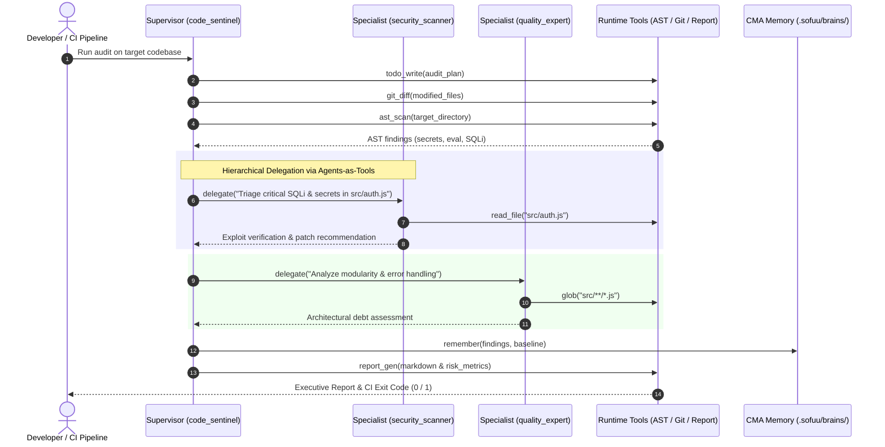

# 🛡️ Code Sentinel — Production AI Agent Example

> **Production-grade, multi-agent code intelligence and security auditing system built natively on Sofuu.**  
> *100% JavaScript (ESM) — Zero auxiliary scripts, zero Node.js runtime baggage, sub-15ms cold start.*

---

## 1. Overview & Architecture

**Code Sentinel** is an autonomous code reviewer and security auditor designed for continuous integration (CI/CD) pipelines and developer workstations. It inspects repositories, scans for vulnerabilities (OWASP Top 10, CWE flaw patterns, secret leaks, code injection), coordinates specialist sub-agents, and produces executive security audit artifacts.

### Multi-Agent Coordination Topology



---

## 2. Key Components

| File | Purpose |
| :--- | :--- |
| [`index.js`](index.js) | Production CLI executable and programmatic SDK entry point |
| [`agent.config.json`](agent.config.json) | 12-factor default configuration (model, budgets, thresholds) |
| [`lib/sentinel.js`](lib/sentinel.js) | Supervisor agent definition (`code_sentinel`) and orchestration |
| [`lib/specialists/security.js`](lib/specialists/security.js) | Vulnerability triage sub-agent (`security_scanner`) |
| [`lib/specialists/quality.js`](lib/specialists/quality.js) | Software architecture sub-agent (`quality_expert`) |
| [`lib/tools/ast_scan.js`](lib/tools/ast_scan.js) | Deterministic static analysis tool (secrets, eval, injection, prototype pollution) |
| [`lib/tools/report_gen.js`](lib/tools/report_gen.js) | Formatted Markdown / JSON report synthesizer and risk scoring engine |
| [`lib/tools/git_diff.js`](lib/tools/git_diff.js) | Safe repository status and diff summary inspector |
| [`lib/memory.js`](lib/memory.js) | Continuous memory learning and historical recall via Sofuu CMA/QTSQ |
| [`tests/test_sentinel.js`](tests/test_sentinel.js) | Automated verification battery |

---

## 3. Quickstart & CLI Usage

### A. Display CLI Help
```bash
./sofuu run production-agent-example/index.js --help
```

### B. Run an Automated Audit on the Current Directory
```bash
# Uses default provider (Anthropic or configured SOFUU_PROVIDER)
./sofuu run production-agent-example/index.js --target ./src

# Explicit model and provider
./sofuu run production-agent-example/index.js \
  --provider anthropic \
  --model claude-3-5-sonnet-20241022 \
  --target ./src \
  --report ./audit-report.md
```

### C. Connect to Local Models (Ollama, vLLM, Local GGUF)
```bash
./sofuu run production-agent-example/index.js \
  --provider ollama \
  --model qwen2.5-coder:7b \
  --base-url http://localhost:11434/v1 \
  --target ./src
```

### D. CI/CD Gate Mode (Pure Machine-Readable JSON)
```bash
./sofuu run production-agent-example/index.js --target ./src --json
```
- **Exit Code 0:** Clean or low-risk audit (Risk Score $\ge 85$).
- **Exit Code 1:** Critical or High security flaws detected (Blocks CI merge).
- **Exit Code 2:** Runtime or configuration error.

### E. Interactive TUI Session
```bash
./sofuu run production-agent-example/index.js --interactive
```

---

## 4. Programmatic SDK Usage

You can embed Code Sentinel directly into your own Sofuu backend services or tools:

```javascript
import { runAudit, defineSentinelAgent } from './production-agent-example/index.js';

// 1. Run audit programmatically
const result = await runAudit({
  target: './src',
  task: 'Audit authentication endpoints for timing attacks and token leaks.',
  provider: 'anthropic',
  model: 'claude-3-5-sonnet-20241022',
  onStep: (event) => {
    console.log(`[Step] ${event.type}: ${event.toolName || ''}`);
  }
});

console.log('Final Report:', result.answer);
console.log('Token Usage:', result.usage);
```

---

## 5. Security Scanner Rules Reference

The built-in [`ast_scan.js`](lib/tools/ast_scan.js) tool detects:

| Rule ID | Category | Severity | Detection Target |
| :--- | :--- | :--- | :--- |
| `SEC-001` | Secret Leak | **CRITICAL** | Hardcoded OpenAI, GitHub, AWS, Slack API tokens |
| `SEC-002` | Secret Leak | **HIGH** | Hardcoded passwords, JWT secrets, private keys |
| `SEC-003` | Code Injection | **CRITICAL** | `eval()`, `new Function()`, `vm.runInContext()` |
| `SEC-004` | Command Injection | **HIGH** | Unescaped string template literals in `exec()` |
| `SEC-005` | Path Traversal | **HIGH** | Direct request parameter concatenation in fs calls |
| `SEC-006` | Prototype Pollution | **MEDIUM** | `__proto__` and prototype property manipulations |
| `SEC-007` | Weak Cryptography | **MEDIUM** | Deprecated hashing (`md5`, `sha1`) |
| `SEC-008` | SQL Injection | **CRITICAL** | Raw SQL queries assembled via string concatenation |

---

## 6. Running Verification Tests

Run the self-contained verification suite:

```bash
./sofuu run production-agent-example/tests/test_sentinel.js
```

All 17 assertions test tool execution, sub-agent registration, risk calculation, and report generation in $< 100\text{ ms}$.
